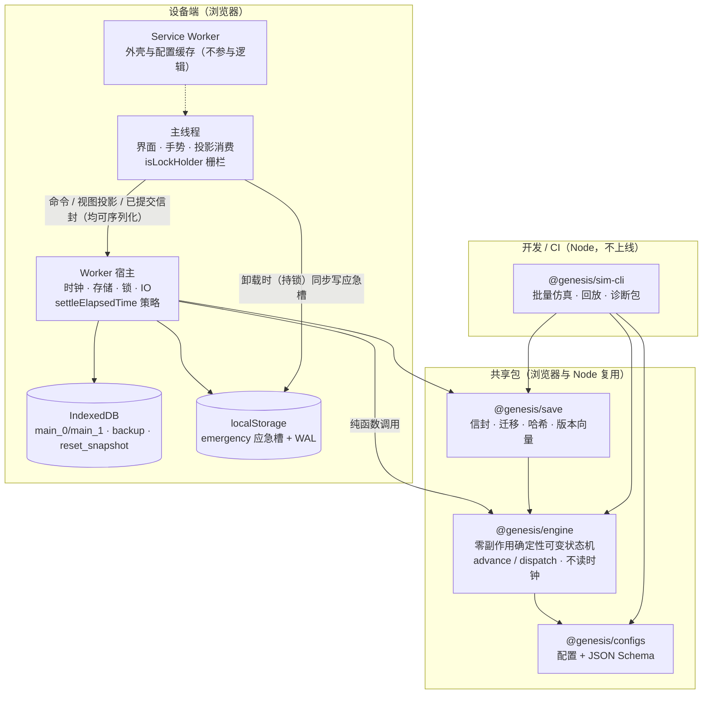

# 创世火种 技术架构设计文档 v2.1（PRD修订3协同版）

本版在 v2.0 的基础上做全面修订，基线升级为《产品需求文档 PRD v3.1（修订 6）》（修订 6 是修订 5 的自洽性收口，本轮据此对齐 FR-04/FR-07/FR-20/FR-48 的映射与版本记录），下文的 FR、NFR、OQ、TQ 编号均指该文档。修订保留 v2.0 已确立的总体方向：引擎运行在专用 Worker、核心为无头确定性引擎、仓库拆为五个包、存档以本地为主并可跨设备接力。本轮只修改本文件，不触碰其他文档；所有改动均在本文内落地，并与既有合理设计兼容。

本版重点修订七类问题：引擎定位（纯函数改为零外部副作用的确定性可变状态机）、事件跳跃的完备性、确定性与门禁口径、WAL 与接管协议、存档谱系与信封校验、诊断与遥测口径、以及数学实现与既有 FR 的走线补全。**本版同步 PRD v3.1 修订 5 的 Evolve 硬核体验口径**：正常周目不以脚本强制制造爆仓、断链或变异，禁止用 tutorialOverrides 制造强制爆仓/断链或教学经济/RNG 污染，引导仅通过渐进解锁与非模态就地说明实现，保底变异仅限可选教学沙盒且以独立配置/run 标识隔离；自动化能力解锁条件来自配置，由引擎命令与视图共同校验，行政算力不因移动端而放宽。**明确不在本版引入**：把资源结算硬约束为 DAG、或对全状态做不可变深拷贝。本版允许有向资源网络（含环），但要求显式定义结算顺序与切环规则（见 5.2.8）。

## 1. 修订摘要

### 1.1 v2.1 修订摘要（相对 v2.0）

下表只列相对 v2.0 有变化或新增的决策；其余设计保持不变并在对应章节完整重述。

| 编号 | 变更主题 | v2.0 的状态 | v2.1 的处理 | 依据 |
| --- | --- | --- | --- | --- |
| 1 | 引擎定位 | 称“引擎是纯函数库” | 改为**零外部副作用的确定性可变状态机**：输入（config、seed、command、elapsedTicks）全部显式注入，advance 原地推进状态并返回含事件列表的 SimResult；config 不引用任何全局单例 | 任务 1 |
| 2 | 时钟策略分层 | advance 内置 24h 截断并直接读墙钟 | **advance 不内置 24h**；墙钟/回拨/24h 截断/毫秒余数策略归 settleElapsedTime（宿主侧策略适配器）；引擎本身不读时钟 | 任务 1 |
| 3 | 引擎与宿主 | Worker 职责笼统 | 明确区分**纯 engine** 与 **Worker 宿主**：宿主负责时钟、存储、锁、IO；engine 只做状态推进与事件产出 | 任务 2 |
| 4 | 事件跳跃 | 列八类事件点，易漏、易 ceil 过冲、随机网格被当成强制切段 | 事件源登记表为唯一真源；**命令边界**加入切分；同 tick 固定顺序；资源边界**段内精确切分**（不 ceil 过冲后钳制）；due-zero 防死循环；智能队列检查**全部可执行候选**；缓存可重建且做全量重算差分；10 秒随机网格是**采样点非强制切段**，只在真实触发时切，24h 不必然 2000 段；**邻国自然变化/冷却/阈值、贸易路线**纳入事件登记 | 任务 3 |
| 5 | 降级策略 | 正常路径有粗步长 + 库存钳制近似降级 | **删除近似降级**；改按**时间片让出 Worker 继续精确结算**；段数异常**报错诊断**、不发布近似结果；MAX 预算只影响让出节拍，**不改变模拟结果** | 任务 4 |
| 6 | 验收口径 | Gate 只比连续量容差 | **离散状态与事件序列必须完全一致**，仅连续量给容差；200 基线**零异常降级**、随机开启；新增耦合链、同 tick、组合律、缓存测试 | 任务 5 |
| 7 | 时钟 | 未区分单调时钟与墙钟 | **单调时钟计步、墙钟只做跨会话差值**并单独处理回拨，二者不混用 | 任务 6 |
| 8 | WAL | atTick 由主线程给、只存 lastKnownTick | **Worker 赋权威 atTick**；持久 lastAppliedCmdSeq/commandId；恢复**按 seq 去重**；savedAtMs 与 lastKnownTick **同刻**；**不因 saveSeq 小就丢 WAL**；每条命令 WAL 基线；localStorage 配额失败提示 | 任务 7 |
| 9 | 接管 | 简单抢占 | **三段 flush + epoch fencing** 接管；声明存储隔离**不能承诺跨容器锁**；只读旧快照导出警告 | 任务 8 |
| 10 | 重置快照 | reset_snapshot 参与普通恢复 | 重置**失败保留**快照；**成功事务快照不进入普通恢复**；单槽回退提示；**启动也迁移** | 任务 9 |
| 11 | 信封与谱系 | 无 engineVersion，CRC 只覆盖负载 | 信封含 **engineVersion**；**头部关键字段与负载副本 CRC 覆盖**；版本向量相同但状态哈希不同**判分叉**；**runId 为 128bit**；明确 **perma/profile 与 run 谱系边界** | 任务 10 |
| 12 | 版本兼容 | 只写“高版本拒绝” | 新 config/schema 高于客户端**拒绝加载且不改原档**；**不再有“高版本只读降级”与“拒绝”两套口径**（旧读新一律拒绝、新读旧走迁移链） | 任务 11 |
| 13 | 诊断缓冲 | 环形缓冲满时丢弃旧输入 | 缓冲满**前移 checkpoint、不丢输入** | 任务 12 |
| 14 | 遥测 | 称“匿名 UUID” | 改称**假名安装 ID**，默认状态**待法务**，不承诺法律匿名 | 任务 13 |
| 15 | 数值实现 | fastPowInt 无域检查、ln 误差笼统、质粒软上限表述误导 | **fastPowInt 域检查**；ln 误差**按域 + 绝对/相对实测**；澄清质粒软上限**只在修饰器变化时重算、不随 tick 改资源速率** | 任务 14 |
| 16 | FR-03 来源界面 | 只提 FR-44 完整分解 | 修正 FR-03：**V1 提供基础来源界面**，完整分解面板仍在后续版本 | 任务 15 |
| 17 | FR-51 走线 | 未覆盖 | 补 FR-51 的**状态/命令/存档/仿真/Bot 路线** | 任务 16 |
| 18 | 技术验证 | S7/S10 只做一次 | M1 的 S7/S10 为**合成预验**，M3 **复验** | 任务 17 |
| 19 | 运行时视图 | 占位嵌入图 | 替换为 **Mermaid 图 + 文本数据流** | 任务 |
| 20 | 架构约束 | — | **不引入 DAG 硬限制或全状态深拷贝**；允许有向资源网络，但须定义结算顺序与切环 | 任务 |
| 21 | Evolve 硬核体验同步 | 引导可脚本化制造爆仓/断链、教学经济/RNG 混入正常周目；自动化与行政算力口径未对齐硬核定位 | **正常周目禁止 tutorialOverrides 制造强制爆仓/断链或教学经济/RNG 污染**；引导只做渐进解锁与非模态就地说明、可跳过；保底变异仅限可选教学沙盒且独立配置/run 标识；自动化能力解锁条件来自配置、由引擎命令与视图共同校验；行政算力不因移动端放宽（见 5.7.1、5.7.2、9 章 Gate 1） | 本轮任务 |
| 22 | 主循环精确性（本轮补齐） | advance 伪代码让 `currentTick` 带小数（`+= dtSec*1000/tickMs`）、并有“段跨 3 tick 却只扣 1 tick”的终止隐患 | **`currentTick` 恒为整数 tick，tick 内进度用整数毫秒定点 `subMilli`（0..999）承载并随存档/哈希持久**；`dtSubMilli` 为整数毫秒、只扣已完整消费的整数 tick；给出终止性论证；5.2.2/5.2.3 的取整口径与 5.2.9 统一；`SegmentBudget` 与 `SimResult` 均增加整数毫秒余量 `remainingMs`，宿主按该值原样续算、不 ceil | 本轮任务 |
| 23 | PRD 修订 6 对齐与 FR-07 新种族闭环 | 未落 FR-04 溢出转化与真菌维生链的区分、三类特殊种族纪元 2 闭环、维生声明的架构走线；§5.9 未编号为 5.8 | 新增 **5.7.2 FR-07 新种族闭环与维生声明**（resourceMap/disabledFeatures/Modifier/vitalResource/vitalJob，Gate 1/6 口径，细则 OQ-13 待评审）；**§5.9 改为 §5.8** 并同步 §5.6 交叉引用；基线升为 PRD 修订 6 | 本轮任务 |

### 1.2 v0.3 类型增补（单列）

v2.0 已把以下类型增量并入正文，v2.1 将其单列，便于配置与实现核对。它们与既有设计一致，仍受同一套确定性与门禁约束：

- **修饰器目标语法增补**（受 Gate 1 校验存在性，类型见 `@genesis/configs` 的 `ModifierTarget`）：
  `res.<资源ID>.upkeep`、`bldg.<建筑ID>.storage`、`bldg.<建筑ID>.upkeep`、`bldg.<建筑ID>.conv`、`all.creep`、`cat.<建筑类别>.creep`、`pop.growth`。覆盖 FR-16、FR-24、FR-26 的需要；蠕变类目标仍受 1.015 硬下限约束（Gate 4）。
- **新配置结构**：溢出转化 `OverflowConversion`（FR-04）与行政算力 `adminPower`（FR-18/19）。
- **状态增补**：宇宙与星级写入 `PermaState.universes` 与 `RunState`；重置命令携带 `universeId` 与 `starLevel`。
- **谱系字段**（v2.1 新增，见 7.4/7.7）：`perma.profileId`（永久档案谱系）与 `run.runId`（周目谱系，128bit）。

## 2. 平台与长线约束

这是网页版挂机游戏：玩家随时在安卓 Chrome、苹果 Safari 或桌面浏览器上打开，目标是像 Evolve 那样能玩 2000 小时以上。这两点让存档可靠性、版本迁移和后台恢复成为最重的设计。

### 2.1 平台矩阵

| 平台 | 支持级别 | 关键约束 | 对设计的影响 |
| --- | --- | --- | --- |
| 安卓 Chrome（含已安装的 PWA） | 一等公民 | 后台标签页计时被节流，系统可回收后台进程 | 唤醒后统一补算；页面隐藏时同步写应急槽 |
| 苹果 Safari（含主屏幕 PWA） | 一等公民 | 切后台或锁屏即挂起；Safari 标签页与主屏幕应用的存储相互独立；长期未访问的站点存储可能被清理（待 S4 实测） | 导出提醒更积极；安装 PWA 前先引导导出；所有功能不依赖后台运行 |
| 桌面 Chrome、Edge、Firefox、Safari（近两个主版本） | 一等公民 | 副屏挂机时窗口失焦但仍可见；同源可能同时开多个标签页 | 失焦不停心跳；Web Locks 单写者 |
| 微信、钉钉内置浏览器 | 降级支持 | Blob 下载、剪贴板、持久化存储常被限制 | 运行时能力探测，分片复制兜底，常驻提示改用系统浏览器 |

### 2.2 长线驱动因素

| 驱动因素 | 为什么重要 | 设计对策 |
| --- | --- | --- |
| 存档要活几年 | 玩家投入数百到上千小时，丢档就是流失 | 双槽位加应急槽加导出提醒（第 7 章）；迁移链保留全部历史版本样本（Gate 5） |
| 版本会持续演进 | 40+ 种族、纪元 8–10、新宇宙陆续上线 | 已发布 ID 永不更改；引擎、结构、配置三个版本号分离（第 10 章） |
| 数值范围随纪元增长 | 纪元 8 之后可能逼近 number 上限 | 用 GameNum 别名封装；Gate 6 记录最大值，超过 1e250 即启动大数方案评估（ADR-06） |
| 永久数据与周目数据 | 重置只清周目数据，永久成长必须受保护 | 状态分为 run 与 perma 两段；重置走事务（7.3） |
| 状态体积随内容增长 | 壮举、图鉴、多宇宙都会增大存档 | 体积预算与分片上限（第 8 章）；周目日志设上限 |
| 会话形态 | 每天多次短会话加长时间挂起 | 在线、后台、离线共用同一个补算入口（5.2） |
| 经常换设备 | 出差时只有手机 | 导入导出、版本向量与分叉检测（7.6、7.7） |

### 2.3 质量属性排序

| 优先级 | 质量属性 | PRD 依据 | 架构含义 |
| --- | --- | --- | --- |
| 1 | 不丢档 | FR-30、FR-31、NFR-06 | 双槽位、应急槽、单写者写锁栅栏、导出提醒 |
| 2 | 确定性与一致 | FR-02、FR-20、NFR-05 | 单一结算内核、整数 tick、定频随机检定网格、核心结算不用原生超越函数 |
| 3 | 手机完整可玩与跨设备接力 | NFR-07、NFR-17、FR-31 | 手机优先交互、系统分享、分片信封、版本向量 |
| 4 | 离线与后台恢复 | FR-20、NFR-08、NFR-09 | 唤醒补算走同一入口，飞行模式全功能可用 |
| 5 | 可测试与可复现 | FR-02、NFR-13 | 无头引擎、Node 批量仿真、本地诊断包 |
| 6 | 性能与包体 | NFR-01、NFR-02、NFR-03 | 引擎放入 Worker；预算见第 8 章，须经 M1 实测确认 |

### 2.4 关键场景

- S1 出差只有手机：飞行模式、锁屏、低电量下，仍能游玩、导出与导入存档。
- S2 手机与电脑接力：一台设备导出，另一台导入并继续，全程不联网。
- S3 后台挂起与副屏常驻：标签页挂起 10 分钟到数小时后恢复，进度正确；桌面窗口失焦但可见时画面保持实时刷新。
- S4 同时开两个实例：Safari 标签页与主屏幕应用、或两个浏览器标签页，不得互相覆盖存档，旧实例关闭时不得污染新实例的应急槽。
- S5 iOS 存储被回收，或主屏幕应用与 Safari 存档不一致：玩家能发现，并能从最近一次导出恢复。

### 2.5 约束

- 无账号、无云存档、无游戏逻辑服务端（假设 A-02）。允许静态托管公告与版本更新，以及可选的匿名遥测。
- 所有玩法数值来自配置表；引擎代码不得出现具体种族、资源或工种 ID（FR-07）。
- 核心引擎零第三方运行时依赖。

## 3. 架构总览

仓库用 pnpm workspace 拆成五个包，依赖单向，边界由构建期 ESLint 规则强制；浏览器与 Node 复用同一份引擎、存档与配置代码。

### 3.1 包拓扑

| 包 | 职责 | 依赖 | 禁止 |
| --- | --- | --- | --- |
| @genesis/configs | 配置数据、JSON Schema、构建期校验（引用完整性、科技无环、纪元可达性、速率单位） | 无 | 任何运行时代码 |
| @genesis/engine | **零外部副作用的确定性可变状态机**：状态、命令、结算内核、命名流随机数、确定性数学、引导状态；输入 config/seed/command/elapsedTicks 全部显式注入，advance 原地推进并返回含事件列表的 SimResult | 仅类型来自 configs；配置数据由调用方注入 | 任何时钟、window、document、Date.now、Math.random、存储 API；不引用全局单例 config |
| @genesis/save | 存档信封编解码、分片、压缩、迁移链、版本向量比较、规范状态哈希、导入校验 | engine（状态类型） | 浏览器专有 API |
| @genesis/sim-cli | Node 批量仿真、回放、诊断包回放、配置校验入口 | engine、configs、save | 无 |
| @genesis/web | 主线程界面、**Worker 宿主（时钟/存储/锁/IO 与 settleElapsedTime 策略）**、存储适配（IndexedDB、localStorage）、Service Worker、分享与剪贴板适配、四种视图、本地化与无障碍 | engine、configs、save | 无 |

> 关键边界：**@genesis/engine 只包含纯状态机，不含任何宿主能力**；**@genesis/web 的 Worker 宿主**独占时钟、存储、锁、IO 与墙钟策略（见 6.1）。二者通过**同步函数调用**（engine，零外部副作用、输入显式注入）与消息（Worker↔主线程）相连，绝不把 DOM、Date、存储句柄传入 engine。

### 3.2 运行时视图



文本数据流（与上图一致）：

1. **输入侧**：主线程把玩家操作包装成 `GameCommand`（经 WAL）发给 Worker 宿主；宿主用 `settleElapsedTime` 把墙钟/单调时钟差换算为整数 `elapsedTicks` 与 `truncatedTicks`。
2. **计算侧**：宿主调用 `@genesis/engine` 的 `advance(state, config, budget)` / `dispatch(state, config, command)`，engine 只读显式注入的 config 与状态、不改外部世界，**就地推进状态**并返回 `SimResult.events`（零外部副作用的确定性可变状态机，不是每步返回新状态）。
3. **持久侧**：宿主经 `@genesis/save` 序列化信封（含 CRC 与 engineVersion），写 IndexedDB 双槽位；主线程仅在持锁且页面卸载时把缓存信封与 WAL 写入 localStorage 应急槽。
4. **输出侧**：宿主向主线程推送视图投影（不高于 4 Hz）与已提交信封确认（清 WAL）；Service Worker 只负责外壳与配置缓存。Node 侧 sim-cli 复用同一 engine/save，仅做仿真、回放与配置校验，不上线。

## 4. 关键决策

十二项决策覆盖一致性、跨端接力、存储可靠性与长线演进；凡带性能数字的判断，都待 M1 技术验证（第 11 章）确认。

| 编号 | 决策 | 理由 | 代价与备选 |
| --- | --- | --- | --- |
| ADR-01 | 引擎运行在专用 Worker，主线程只做界面 | 24 小时补算可能占用数百毫秒以上，放在主线程会卡住界面，低端 iPhone 更明显 | 只传视图投影；仅在初始化、重置、导入预览时传受控快照。不用 SharedArrayBuffer，因为它需要跨源隔离响应头，静态托管与内置浏览器难满足。备选：主线程引擎加心跳 Worker |
| ADR-02 | 单一结算内核：同一套阶段函数，只改变步长的选取（固定 1 tick 或事件跳跃） | 两套算法必然存在分叉 | 段内速率须保持常数，事件检测须覆盖所有改变速率的来源；Gate 3 兜底 |
| ADR-03 | 时间轴用整数 tick，单 tick 时长由 tickMs 定义（生产固定 250 ms） | 冷却、季节、订单、随机检定都用整数 tick，避免浮点秒漂移 | Gate 2 以 tickMs = 100 / 250 / 1000 初始化实例并传入整数 tick |
| ADR-04 | 不对状态做逐步定点量化 | 每步取整会丢掉小增量，并使结果依赖步长 | 只在显示与阈值比较处用容差 EPSILON = 1e-9 |
| ADR-05 | 核心结算不调用原生 pow、exp、log；概率修饰在概率空间做乘加并钳制 | 不同引擎的超越函数尾数可能差 1 ULP | 成本用整数次幂；基础概率在构建期预计算；动态修饰用 p = min(1, p0 × m + a)；软上限对数用确定性级数（5.6） |
| ADR-06 | V1.0 用 number，GameNum 别名预留替换点 | 纪元 1–7 内 N = 1000、系数 1.28 时成本约 1.6e107，低于 number 上限 | 仿真最大值超过 1e250，或纪元 8 设计需要时，改用大数库 |
| ADR-07 | 存档信封用 deflate 压缩加标准 base64url，带长度、CRC32 与终止标 | lz-string 字母表含加号与美元符，粘贴到部分输入框可能被改写 | 引入 fflate；浏览器原生压缩流为备选 |
| ADR-08 | 存档单写者：Web Locks 加写锁栅栏，第二个实例只读 | 同源多标签页会互相覆盖；旧标签页关闭时不得污染应急槽 | 只读实例提示“另一个窗口正在游玩”，玩家可接管 |
| ADR-09 | 商队订单满 24 小时滚动刷新 | 出差跨时区时，日历日会提前或延后刷新 | 以最大已观测时间戳防回拨；拨快属单机宽容范围，不处罚 |
| ADR-10 | V1.0 不做服务端；信封预留谱系字段 | 满足假设 A-02 | 若 OQ-14 批准云接力（FR-50），只需新增传输层 |
| ADR-11 | 状态分为 run 与 perma 两段，重置只替换 run | 长线游玩下，永久成长不得被重置事务误伤 | 同一信封内两段分别校验 |
| ADR-12 | 引导状态与引导专用配置放在引擎内，但只降门槛、不制造灾难 | 回放与离线补算必须走同一逻辑；硬核体验要求正常周目不脚本化灾难 | civ.tutorialStage 随存档保存；tutorialOverrides 仅降纪元 1 门槛，保底变异限可选沙盒（独立配置/run 标识） |

## 5. 引擎设计

引擎是**零外部副作用的确定性可变状态机**，不是纯函数库。它的输入（config、seed、command、elapsedTicks）全部由调用方显式注入，引擎不读取系统时钟、不访问存储、不引用任何全局单例；`advance(state, config, budget)` 就地（in place）推进 `state` 并返回一个 **SimResult**（含本次推进产生的事件列表），`dispatch(state, config, command)` 就地应用命令。之所以采用“可变状态机”而非“每步返回新状态”：状态体积随纪元增长，若每步深拷贝整棵状态树会带来不必要的分配与 GC 抖动，且与“不引入全状态不可变深拷贝”的约束一致；**确定性由“输入显式、零外部副作用、遍历顺序固定”保证，而非由不可变性保证**。在线游玩、后台恢复、离线结算与 Node 仿真都调用同一个 `advance`，区别只在每次传入多少 tick，以及宿主如何用 `settleElapsedTime` 计算这段 tick。

> 定位澄清：**纯** 指“无外部副作用、结果只由显式输入决定、可重放”；**可变** 指“原地修改传入的 state 并返回事件”。二者不矛盾：确定性来自副作用为零与输入完整，而非来自返回新对象。

### 5.1 对外接口

- `createState(config, seed, tickMs = 250)`：由**显式注入**的 config、seed 与单步毫秒基准生成初始状态，状态是可序列化的普通对象，分为 run（周目）与 perma（永久成长）两段。生产环境 tickMs 固定为 250，Gate 2 分别传入 100、250、1000。**config 只经函数参数在每次 `advance`/`dispatch` 调用时显式传入，不写入状态、不在 `state` 上保留 `state.config` 之类的配置引用**；引擎内部不读任何全局配置单例，也不缓存配置句柄。
- `advance(state, config, budget): SimResult`：唯一的时间推进入口。**advance 不内置 24 小时上限、不读取墙钟、不处理回拨**——这些属于宿主策略（5.3）。在线每次传入 1 tick 的预算；唤醒/离线由宿主用 `settleElapsedTime` 换算后传入实际 tick 预算。返回的 `SimResult` 至少含 `events`（按发生顺序）、`segmentsRun`、`ticksAdvanced`（按预算定义）、`remainingTicks`、`remainingMs`（tick 内整数毫秒余量，与 `SegmentBudget.remainingMs` 配对，见 5.2.9；**不含**旧版的 `yieldSlices`；让出节拍是宿主用 `maxSegmentsThisSlice` 控制的，不是引擎返回值）。
- `dispatch(state, config, command): SimResult`：所有玩家操作（切工种、建造、改队列、种试验田、重置）封装成可序列化的 GameCommand，就地应用并返回其产生的事件；状态对外只读（AC-04）。
- `settleElapsedTime` **不属于 engine**：由 Worker 宿主实现（5.3），把单调时钟/墙钟差换算为 `ticks` 与 `truncatedTicks`，再把 `ticks` 作为 budget 交给 `advance`。
- 引擎禁止：window、document、存储 API、Date/Intl、performance.now、Math.random、任何全局可变单例。

### 5.2 单一结算内核

内核把时间切成“段”，段内所有速率保持常数，可用解析式一次推进整段。段内时间增量 dt = stepTicks × tickMs / 1000（游戏秒）。固定步长是段长恒为 1 tick 的特例，事件跳跃是段长取到下一个事件为止的特例，两者调用同一组阶段函数，不存在第二套公式。

#### 5.2.1 四阶段

每段按下列四个阶段顺序执行，阶段之间单向、无回环（四阶段之间无反向依赖，Gate 1 校验）：

1. 修饰器与上限：重算有效蠕变系数、仓储上限、支撑配额。按目标属性分桶做脏标记缓存（5.2.7），仅在建筑、科技、季节、污染档位、邻国关系或精通里程碑变化时重算对应属性。
2. 电网与负载：按优先级 1–5 分配电力与太空维生配额，得到各建筑满足率。
3. 资源流转：基础采集、维生消耗、工坊转化、爆仓拦截，同时按亚步长切分推进断链计时与工种精通经验。
4. 生态与内政：试验田生长与邻接变异、排程队列、迟滞人口调拨、季节切换、污染档位更新、邻国与贸易的自然演化和定频随机检定。

#### 5.2.2 事件源登记表（唯一真源）

所有会改变“段内速率或阈值”的来源必须在事件源登记表中登记；登记表是事件检测的**唯一真源**，新增机制若引入速率/阈值变化却未登记，Gate 判为阻断缺陷。下表为登记表（含 v2.0 遗漏项）：

| 组 | 事件源 | 触发条件 | 求取方式 |
| --- | --- | --- | --- |
| A 连续边界 | 资源满仓/耗尽 | 未满仓且净速率为正 / 有库存且净速率为负 | 求距边界时间，段内**精确切分**（5.2.3） |
| B 阈值 | 迟滞触发/释放线、污染档位、断链阈值、换季 60s 预警 | 当前未越过且方向指向阈值 | 解线性/分段解析式 |
| C 排程 | 队列项可执行 | 任一可执行候选攒够资源（5.2.5 全部候选） | 取所有候选的最小时间 |
| D 生态 | 试验田成熟 | 种植格成熟瞬间 | 取最近成熟格 |
| E 断链 | 一级确认/二三级阈值/三级预热结束 | 状态跃迁 | 由 5.5 公式给出切点 |
| F 精通 | 每 10 级及 99 级加成点 | 活跃工种经验达阈值 | 解经验累积速率 |
| G 计时器 | 迟滞冷却结束、污染崩溃倒计时、季节边界、订单刷新边界 | 到点 | tick 边界直接比较 |
| H 随机采样网格 | hazard 采样点 | 落在 gridTicks 整数倍 | 见 5.2.6，**采样非强制切段** |
| I 命令边界 | 玩家命令到达 | 命令携带 atTick | 段在 atTick 处切开（5.2.4） |
| J 邻国 | 邻国自然变化、冷却结束、阈值跨越（关系/威胁/贡赋档） | 速率或阈值变化 | 与 B/G 同法求点 |
| K 贸易路线 | 路线开通/中断、运量档位变化、到达结算点 | 速率或阈值变化 | 与 B/G 同法求点 |

- **due zero 防死循环**：当某事件点计算结果为 0（当前 tick 恰在边界、且状态尚未被该边界处理推进）时，本段必须至少消耗 1 tick 或先执行该边界处理再重算，绝不能以 0 长度循环重试；每段推进的 tick 数恒 ≥ 1。
- 事件距离：所有周期在配置表以“游戏秒”声明（FR-01），运行时 `secToTicks(sec) = Math.round(sec × 1000 / tickMs)` 只用于**离散周期**（冷却、刷新、季节边界等以整 tick 对齐的量）；**连续资源边界**（满仓/耗尽）改用整数毫秒定点：`t_full_ms = floor(((max − cur) / rate) × 1000)`（tickMs 以毫秒计），转定点时一律向下取整、**绝不 ceil 过冲**（见 5.2.3、5.2.9）。两类量的区别：离散周期允许 `round` 到整 tick；连续边界必须保留毫秒级残量，否则不同步长会因取整方向不同而分叉。

#### 5.2.3 资源边界段内精确切分（不 ceil 过冲后钳制）

v2.0 的做法是“把段长 ceil 到下一事件再执行，事后 clampInventoryToBounds 钳制库存”。这会引入与步长相关的误差：ceil 过冲使库存先冲过上限再被钳回，跨设备/跨段长不一致。v2.1 改为**段内精确切分**：

- 对每个未满仓且净速率为正的资源，计算距满仓时间 `t_full = (max − cur) / rate`；对每个有库存且净速率为负的资源，计算距耗尽时间 `t_empty = cur / (−rate)`。
- 取所有边界时间与本步剩余时间的**最小值**作为本段时长，**不做 ceil**；执行阶段 3 后，把刚好到达边界的资源钳到边界值（此时差值应为 0 或仅浮点尾差 ≤ EPSILON，不构成“过冲后钳制”）。
- 边界可落在 tick 内（以整数毫秒定点 `subMilli` 表示，见 5.2.9）：把该 tick 切分为“到达边界的一段 `dtSubMilli` + 边界后处理的一段 `tickMs − dtSubMilli`”，边界处理（爆仓转化 OverflowConversion、耗尽断链计时）与边界在**同一 tick 内**完成；绝不允许“整 tick 先冲过再钳回”。当 `dtSubMilli=0`（状态已恰在边界）时，按 5.2.2 的 due-zero 规则先执行边界处理再推进，不产生 0 长度段。
- 边界稳态排除：已满仓或已耗尽的资源本身不产生事件，避免满仓资源把步长压成 1 tick。

#### 5.2.4 命令边界与同 tick 固定顺序

- **命令边界**：`dispatch` 携带 `atTick`。`advance` 推进到 `atTick` 时必须先切分，在恰好 `atTick` 处结束上一段、执行命令、再继续；命令绝不允许“跨越段边界插队”。这保证逐 tick 与事件跳跃在命令生效时刻上完全一致。**统一口径：所有命令只由宿主在“推进到其边界”后通过 `dispatch` 施加；`advance` 内部不维护隐式命令队列、不会自行发起或排队任何命令**（`SimResult.events` 只是事件产出，不是命令来源），两者职责不混用。
- **同 tick 固定顺序**：一个 tick 内若多个事件同时到期，按固定顺序处理，保证可重放：
  1. 阶段 1 修饰器/上限重算 → 2. 阶段 2 电网分配 → 3. 阶段 3 资源与精通（含资源边界精确切分） → 4. 阶段 4 离散事件（按登记表组序 A→K，同组内按配置声明顺序） → 5. 本 tick 命令（按 cmdSeq 升序） → 6. 随机采样（若该 tick 为网格点）。
- 上述顺序对逐 tick 与事件跳跃两种步长**完全一致**，是 Gate 2「离散状态与事件序列必须完全一致」的基础。

#### 5.2.5 智能队列检查全部可执行候选

- 排程事件不再只看队首：智能防卡死模式下，检查队列中**全部可执行候选**（未标记“上限锁死”、前置满足、资源可负担），取其中最早可执行者的时间作为事件点，据此放宽“队首阻塞”。
- 队首若因“上限锁死”长期不可执行，不得让它把段长压成 1 tick 空转；智能模式将其跳过，改由下一个可执行候选推进，并在事件日志记录一次“队首被跳过”。
- 逐 tick 模式与事件跳跃必须得到相同的“本 tick 可执行集合”，否则 Gate 3 判分叉。

#### 5.2.6 随机网格是采样点，非强制切段

- `gridTicks = secToTicks(hazardIntervalSec)`（默认 10 游戏秒）是**随机数的采样点**：只有当某个 tick 恰为 gridTicks 整数倍时才抽取 hazard 随机数。它**不是强制切段点**——若一段跨越多个网格点，则在段内按网格点精确切分以抽取（或段末补抽已跨过的网格点），但网格点本身**不因为“存在”而把 24h 强制切成固定段数**。
- 因此 24 小时离线（86400 秒 / 10 秒 = 8640 个采样点）**不必然产生 2000 段**：段数取决于真实事件密度，而不是采样点数。只有当资源边界、阈值、队列、断链、命令等真实事件确实落在该处时才切段。
- 逐 tick 与事件跳跃必须抽到**完全相同的采样序列**：事件跳跃在跨过网格点时不可丢弃采样，必须在同一 tick 边界先采样再继续。

#### 5.2.7 缓存可重建且做全量重算差分

- 阶段 1 的脏标记缓存（按目标属性分桶）是**纯派生量**，必须满足“可随时丢弃并重建”。禁止把缓存结果写回状态作为权威数据。
- 缓存可重建性用“**全量重算差分**”校验：Gate 用一个关闭缓存的全量重算实现作对照，逐属性比较，差分必须为零（连续量 ≤ EPSILON）。
- 缓存失效键必须覆盖全部登记来源：建筑/科技/季节/污染档位/邻国关系/精通里程碑变化时，对应桶失效并重算。漏失效即判为分叉。

#### 5.2.8 有向资源网络：结算顺序与切环

本版**不把资源结算硬约束为 DAG**，允许存在有向资源网络（含环，如 A 产 B、B 产 A 的共生回路）。但必须显式定义：

- **结算顺序**：阶段 3 内按“配置声明顺序 + 稳定拓扑序”处理；对同一强连通分量（环）内的资源，按配置声明的固定顺序做一次同步扫描（同 tick 内使用进入该 tick 时的存量快照作为输入，产出记为本 tick 净增量），避免顺序依赖。
- **切环规则**：环内若因净负项无法同 tick 收敛，按“优先级 + 字典序”选一个资源作为该 tick 的“锚”，其余按锚结算；锚的选择规则写入配置并由 Gate 4 覆盖。切环只影响同 tick 内的解析顺序，不改变长期守恒。

#### 5.2.9 advance 主循环（精确、无近似降级、可让出）

以下伪代码只表达调度契约。**关键约定：`currentTick` 恒为已完整消费的整数 tick；`subMilli` 是当前 tick 内已消费的整数毫秒，满足 `0 <= subMilli < tickMs`。** 预算以“整 tick 数 + 当前亚 tick 余量”共同计量；事件距离必须减去当前 `subMilli`，不能从 tick 起点重复计算。连续边界与离散事件都在同一绝对时间轴上处理。

```ts
export interface SimEvent { atMilli: number; seq: number; group: string; kind: string; payload: unknown; }
export interface SegmentBudget {
  ticks: number;                 // 本次任务要推进的完整 tick 数，由宿主计算；恒为整数
  remainingMs: number;           // 进入本次调用的 tick 内整数毫秒余量，0 <= remainingMs < tickMs；首次为 0，续算时把上一次 SimResult.remainingMs 原样传入（宿主不得自行 ceil 成整 tick，否则会重复推进）
  maxSegmentsThisSlice: number;  // 本时间片最多执行的段数；只影响让出节拍，不影响结果
}
export interface SimResult {
  events: SimEvent[];
  segmentsRun: number;
  ticksAdvanced: number;   // 按预算定义：本次从预算整 tick 中已完整消费的整数 tick 数（= budget.ticks − remainingTicks）
  remainingTicks: number;  // 预算中尚未消费的完整整数 tick 数（向下取整，不 ceil）
  remainingMs: number;     // 预算中尚未消费的整数毫秒余量，0 <= remainingMs < tickMs；remainingTicks×tickMs + remainingMs 恰等于未消费毫秒，宿主下次把它原样放进 SegmentBudget.remainingMs 续算，绝不把余量 ceil 成整 tick 而重复推进
  completed: boolean;      // remainingTicks === 0 && remainingMs === 0
}

export function advance(state: GameState, config: Config, budget: SegmentBudget): SimResult {
  const events: SimEvent[] = [];
  const tickMs = state.meta.tickMs;
  // 预算总毫秒 = 整 tick 毫秒 + 上一时间片遗留的整数毫秒余量（不 ceil）
  let remainingSubMilli = budget.ticks * tickMs + budget.remainingMs;
  let segmentsRun = 0;
  while (remainingSubMilli > 0 && segmentsRun < budget.maxSegmentsThisSlice) {
    const beforeMs = state.meta.currentTick * tickMs + state.meta.subMilli;
    processDueEventsAtCurrentTime(state, config, events); // 到期事件先改变状态；无进展则报异常
    recalcDirtyModifiersAndCaps(state, config);
    resolvePowerAndSupportGrid(state, config);
    computeConstantSegmentRates(state);

    // 返回相对当前时刻的非负整数毫秒距离，含离散计时器、命令及真实连续边界。
    const nextMs = earliestRegisteredEventDeltaMs(state, config);
    const dtSubMilli = Math.min(remainingSubMilli, nextMs);

    executePhase3ResourceAndMasteryExact(state, dtSubMilli);
    const absoluteMs = beforeMs + dtSubMilli;
    state.meta.currentTick = Math.floor(absoluteMs / tickMs);
    state.meta.subMilli = absoluteMs % tickMs;

    stepDueDiscreteEventsFixedOrder(state, config, absoluteMs, events);
    consumeHazardSamplesThrough(state, config, absoluteMs, events);
    assertStageInvariants(state);

    remainingSubMilli -= dtSubMilli;
    segmentsRun++;
  }
  // 未消费毫秒 remainingSubMilli 按整数毫秒拆成“完整 tick + 余量”，绝不 ceil 余量
  const remainingTicks = Math.floor(remainingSubMilli / tickMs);
  const remainingMs = remainingSubMilli - remainingTicks * tickMs;
  return {
    events, segmentsRun,
    ticksAdvanced: budget.ticks - remainingTicks,   // 按预算定义：已消费整 tick = 预算 tick − 剩余 tick
    remainingTicks,                                 // 向下取整，不 ceil
    remainingMs,                                    // 0..tickMs-1，宿主下次原样放进 SegmentBudget.remainingMs 续算
    completed: remainingTicks === 0 && remainingMs === 0,
  };
}
```

要点：

- **状态恒定整数 tick**：`currentTick` 永不出现小数；tick 内进度只存于 `state.meta.subMilli`（毫秒），属于可序列化的整数状态，随存档保存。这样逐 tick 记账（每段 `dtSubMilli = tickMs`，余量恒为 0）与事件跳跃记账（段长取到事件点的整数毫秒）得到**完全相同的整数状态序列**——这正是 Gate 2「离散状态逐位一致、仅连续量给容差」能够成立的前提；若让 `currentTick` 带小数，则两种步长的浮点累加顺序不同必然产生 ULP 级分歧。
- **不 ceil 过冲、不事后钳制**：`dtSubMilli` 取剩余与到下一事件点毫秒量的最小值，边界处理（爆仓转化、耗尽断链计时）与边界在同一整数毫秒内完成（5.2.3）。
- **due-zero 防死循环**：`processDueZeroEvents` 若在当前 tick 反复取到同一 0 距离事件且状态未变，立即记 `DIAG_SEGMENT_ANOMALY` 并中止本 slice（5.2.10），绝不 0 长度重试；因此每段至少消费 1 个整数毫秒或推进 currentTick。
- **宿主续算语义**：`completed=false` 时宿主以同一状态、把上一次返回的 `remainingTicks` 与 `remainingMs` 原样放进下一次 `SegmentBudget`（`remainingMs` 是**未消费预算**的亚 tick 余量；绝对进度仍由 `state.meta.subMilli` 保存，两者不得混用）继续调用 `advance`；**绝不把余量 ceil 成整 tick 再推进**，否则会把已消费的毫秒重复计入下一 tick。`ticksAdvanced` 按预算定义 = `budget.ticks − remainingTicks`，不另设口径。`maxSegmentsThisSlice` 仅决定让出时机，**不改变模拟结果**（把一次 `advance(totalTicks)` 拆成多次，结果一致，Gate 3 组合律）。随机采样按时间顺序逐个消费，未触发状态变化的采样不形成模拟段。
- **终止保证**：`remainingSubMilli` 单调不增，且段数受 `maxSegmentsThisSlice` 限制；零点事件必须先改变状态，否则立即诊断中止。只要每个事件候选都能给出有限的非负整数毫秒距离，循环必然在有限步内结束。
#### 5.2.10 段数异常诊断（不发布近似结果）

- 若段数异常膨胀（例如超过诊断阈值 `diagSegmentWarn`，或单次推进出现疑似空转），引擎**不退回近似降级**，而是记录一条 `DIAG_SEGMENT_ANOMALY` 事件，由宿主弹出诊断提示并生成诊断包（8.5）。宁可让玩家看到“计算异常”，也不发布与逐 tick 不一致的结果。
- Gate 3 / S2 用该事件计数验证“零异常降级”。

### 5.3 时钟：单调时钟与墙钟分离（宿主策略 settleElapsedTime）

引擎本身不读时钟；所有时间换算在 Worker 宿主侧完成。宿主严格区分两种时间源：

| 时间源 | 用途 | 规则 |
| --- | --- | --- |
| 单调时钟（performance.now 等） | 在线心跳、计步 | 只用其**差值**推进 tick；不受墙钟跳变影响；用于可见状态下的每 250ms 推进 |
| 墙钟（wall-clock 时间戳） | 跨会话/跨后台的离线差值 | 只用于“上次活动时间戳 → 现在”的**跨会话**差值；单独处理回拨与超限 |

`settleElapsedTime(prevWallMs, nowWallMs, monotonicDeltaMs, cfg)` 由宿主实现：

1. **在线**（页面可见、连续心跳）：用 `monotonicDeltaMs` 换算 tick，余数毫秒留给下一次；墙钟不参与计步。
2. **后台/离线恢复**：用 `nowWallMs − prevWallMs` 得墙钟差；若为负（回拨），`ticks = 0` 并提示（FR-32），不扣任何库存；若为正，`ticks = floor(diff / tickMs)`，余数毫秒留待下次。
3. **24 小时上限在这里施加**（不进入 engine）：`maxTicks = secToTicks(maxOfflineSec)`（默认 86400 秒 = 345600 tick）；`usable = min(ticks, maxTicks)`，`truncatedTicks = ticks − usable`。返回 `{ ticks: usable, truncatedTicks, rolledBack }`。
4. 宿主把 `{ticks, truncatedTicks}` 填入 budget 传给 `advance`；advance 只推进 `ticks`；离线报告用 `truncatedTicks` 提示“超出 24 小时的部分未结算”（FR-20）。

这样 engine 的时间语义保持纯粹（只认 elapsedTicks），24h、回拨、余数这些“墙钟策略”集中在宿主一处，便于测试与替换。

### 5.4 精确结算与预算让出（删除近似降级）

- **不采用“粗步长 + 库存钳制”的近似降级**：任何情况下都必须得到与逐 tick 一致的结果。
- 长时间补算（例如 24h）按**时间片让出 Worker**：宿主给 `advance` 传 `SegmentBudget`（如“每 N 段或每 T 毫秒让出一次”）。让出时保存完成进度（currentTick 已推进到何处），主线程得以刷新进度条；恢复后从同一状态继续精确结算。**让出只影响调度，不改变任何数值**——把一次 `advance(totalTicks)` 拆成多次 `advance` 推进，结果一致（Gate 3）。
- `MAX_SEGMENTS`/预算阈值仅用于“决定让出节拍与是否发出段数异常诊断”，**不得改变模拟结果**。确属段数异常时按 5.2.10 报错诊断，而不是发布近似值。
- 预计补算超过 1 秒时显示进度条；补算期间界面只读。

### 5.5 断链结算

库存 S、上游产出 P、下游需求 D 满足 D > P 且 S > 0 时，一段 dt 内必须切成满载段与欠载段，结果才与步长无关（FR-06）：

```latex
\Delta t_{\text{full}} = \min\!\left(\Delta t,\ \frac{S}{D-P}\right),\qquad \Delta t_{\text{starve}} = \Delta t - \Delta t_{\text{full}},\qquad \eta_{\text{steady}} = \frac{P}{D}
```

满载段满足率为 1，欠载段按稳态满足率 η 结算。只有 η 低于断链阈值（默认 50%）时，欠载时间才累加进断链计时。供给回升到断链阈值与完全恢复线（默认 85%）之间时，计时暂停累加但保持当前级别；超过完全恢复线后计时按配置速率衰减，三级断链须先完成预热爬坡。一级的确认延迟 l1ConfirmSec 只影响事件日志与埋点，避免瞬时抖动刷屏，不影响欠载期间的产出结算。该切分与 5.2.3 的资源边界精确切分共用同一“段内切分”实现。

### 5.6 随机数

- 固定算法的确定性 PRNG（Mulberry32），32 位整数状态随存档保存；禁止 Math.random。
- 按用途拆成独立的命名流：hazard（灾难、暴动）、eco（试验田变异）、tutorial（**仅可选教学沙盒的新手保底，正常周目不使用**）、diplomacy（邻国行动成败与邻国随机检定，5.8）。每个流的初始状态由主种子与流编号经整数哈希混合得到，给一个系统新增随机调用不会改变其他系统的序列。
- hazard 流只在网格采样点抽取（5.2.6，采样点非强制切段）；eco 流只在作物成熟瞬间按格子索引升序抽取；diplomacy 流只在执行邻国行动（dispatch）或配置启用的邻国定频检定点抽取，二者均与步长无关。
- 周期评估：hazard 流按每 10 游戏秒抽 1 次，2000 小时约 72 万次，远低于 Mulberry32 的 2^32 周期，V1.0 不更换算法；若后续某个流的抽取量逼近周期的 1%，再评估更长周期的算法。

### 5.7 确定性三级契约与数学实现

| 级别 | 承诺 | 验证方式 |
| --- | --- | --- |
| 1 同设备同引擎版本同配置 | 逐位一致（承诺） | Gate 2 的硬性部分，每次提交 |
| 2 跨浏览器与跨内核 | 目标是状态哈希一致；不满足时降级为容差内一致且无事件分叉 | Spike S3 判定；Gate 2 的跨内核部分在 S3 通过前为观察项，不阻断合并 |
| 3 导入他端存档 | 只保证导入当刻规范状态哈希一致，不承诺此后模拟逐位一致 | Gate 5 往返测试 |

- 禁用 API：window、document、存储 API、Date、Intl、Math.random。
- 算术约束：核心结算不用原生 pow、exp、log、sin、cos；允许加减乘除、sqrt、abs、min、max、floor、ceil（IEEE-754 规定基础四则与平方根精确舍入）。
- 概率修饰一律在概率空间做乘加并钳制，p = min(1, p0 × m + a)，其中 p0 由构建期按固定检定周期预计算；不在速率空间求指数。
- 遍历顺序固定：按配置声明的数组顺序遍历，不依赖对象键的枚举顺序；排序必须带全序比较器，数值相等时以内部 ID 字典序决胜。
- 阶段末断言：所有库存与速率为有限值且库存非负，违反则中止当前步并生成诊断快照。

```ts
// 成本蠕变 C1 × creep^N：N 为非负整数，用固定结合顺序的平方乘法；含域检查
export function fastPowInt(base: number, exp: number): number {
  if (!Number.isFinite(base) || base < 0) throw new RangeError('fastPowInt: base out of domain');
  if (!Number.isInteger(exp) || exp < 0) throw new RangeError('fastPowInt: exp must be non-negative integer');
  let res = 1.0, b = base, e = exp;
  while (e > 0) {
    if (e % 2 === 1) res = res * b;
    b = b * b;
    e = Math.floor(e / 2);
  }
  return res;
}

// 质粒软上限用的 ln(1 + u)：提取 IEEE-754 指数与尾数，按 √2 折半归约后用 5 项级数
const LN2 = 0.6931471805599453, SQRT2 = 1.4142135623730951;
export function deterministicLn1p(u: number): number {
  if (!Number.isFinite(u) || u < 0) throw new RangeError('deterministicLn1p: invalid domain');
  const x = 1.0 + u;
  if (x <= 1.0) return 0.0;
  const f64View = new DataView(new ArrayBuffer(8)); // 每次调用独立，避免模块级可变共享状态
  f64View.setFloat64(0, x, false);
  const hi = f64View.getUint32(0, false);
  let k = ((hi >>> 20) & 0x7ff) - 1023;
  f64View.setUint32(0, (hi & 0x000fffff) | 0x3ff00000, false);
  let m = f64View.getFloat64(0, false);
  if (m > SQRT2) { m = m * 0.5; k = k + 1; }
  const z = (m - 1.0) / (m + 1.0), z2 = z * z;
  const poly = 1.0 + z2 * (1.0 / 3.0 + z2 * (1.0 / 5.0 + z2 * (1.0 / 7.0 + z2 * (1.0 / 9.0))));
  return k * LN2 + 2.0 * z * poly;
}
```
### 5.7.1 新手引导与自动化渐进解锁

正常周目与可选教学沙盒严格分离。正常周目只通过配置分阶段解锁机制并显示非模态就地说明；不得用脚本强制制造爆仓、断链或变异。`isPracticeRun=true` 的沙盒才可使用独立保底规则，且其产物、成就和随机流不得进入正常永久成长。

- `civ.tutorialStage`、`isTutorialRun`、`isPracticeRun` 随 run 存档；`perma.profileId` 标识永久档案。
- 纪元 1 的门槛调整只可使用已声明的 `tutorialOverrides`，不得注入危机或改变正常周目的变异结果；可选沙盒使用独立配置与独立 runId。
- 种族锁定前使用配置中的临时维生声明，锁定后切换为种族声明；FR-18 的默认保底规则按配置解锁，不在纪元 1 强制启用。
- FR-48 的规则槽位、队列长度、自动补种等能力由纪元、科技和重置条件统一计算。引擎在 dispatch 与离线推进时都校验解锁状态，未解锁的策略不得执行；视图只负责展示条件。
- 行政算力和失败惩罚对手机与桌面完全一致；自动化只执行玩家已经设定且已解锁的策略。

```ts
export interface Modifier {
  id: string;
  source: 'race' | 'tech' | 'catalyst' | 'prestige' | 'universe' | 'event' | 'tutorial';
  sourceId: string;   // 保留来源配置 ID，供 FR-44 数值来源分解面板使用
  target: string;     // 例如 res.lumber.rate、bldg.smelter.creep
  op: 'add_base' | 'add_pct' | 'mul' | 'override';
  value: number;
}
```

- 同一目标的结算顺序固定为 add\_base、add\_pct、mul、override；同类内按 id 字典序。
- **来源界面口径（修正 FR-03）**：V1 **提供基础来源界面**——每个数值属性可展开查看“该属性当前由哪些来源构成、各贡献多少”，按 `source`（种族/科技/催化/威望/宇宙/事件/引导）与 `sourceId` 分组列出基础值、各类修饰的贡献量与最终值。FR-44 的**完整分解面板**（逐条列出每个 Modifier、支持跳转到来源、叠加顺序可视化）在后续版本增强，但 V1 的基础来源界面已依赖 `sourceId` 字段，故**不在 V1 删减 sourceId**。这样既不把 FR-44 的完整面板提前塞进 V1，也避免“V1 完全不做来源展示”的返工。
- Modifier 只用于数值属性的结算；FR-07 的种族资源替换与系统废除，通过种族配置中的 resourceMap（资源 ID 到资源 ID）与 disabledFeatures（被废除的系统列表）独立声明，不走 Modifier。

修饰器目标语法：`res.<资源ID>.rate`、`res.<资源ID>.max`、`job.<工种ID>.rate`、`bldg.<建筑ID>.creep`、`bldg.<建筑ID>.cost`。v0.3 增补 res.<资源ID>.upkeep、bldg.<建筑ID>.storage、bldg.<建筑ID>.upkeep、bldg.<建筑ID>.conv、all.creep、cat.<建筑类别>.creep、pop.growth，覆盖 FR-16、24、26 的需要，蠕变类目标仍受 1.015 硬下限约束。目标里的 ID 是否真实存在由 Gate 1 校验，类型见 @genesis/configs 的 ModifierTarget。同版还新增溢出转化（OverflowConversion，FR-04）与行政算力（adminPower，FR-18/19）两个配置结构，存档中的宇宙与星级写入 PermaState.universes 和 RunState，重置命令携带 universeId 与 starLevel。

### 5.7.2 FR-07 新种族闭环与维生声明的架构走线

同步 PRD v3.1 修订 6：FR-04 的溢出转化（满仓回收）与真菌「原木→有机废料→堆肥」维生主链是**两套不同机制**，不得共用同一规则或数值口径；后者是维生资源的常规输入，走资源网络而非 OverflowConversion。

- **种族 = 规则替换，非数值皮肤**：种族差异只经四类配置表达，引擎不含任何具体种族逻辑——`resourceMap`（资源 ID→资源 ID 的替换，如植物以光合作用替代农田/肉类）、`disabledFeatures`（被废除系统列表，如真菌/肉食无农业）、`Modifier`（数值修饰）、`ruleSwitches`（规则开关）。引擎只识别这些配置结构与声明，不出现 `fungal`/`carnivore`/`silicon` 等种族 ID 字面量（Gate 1 静态扫描 0 处）。
- **维生声明绑定**：每个种族必须在配置中声明 `vitalResource` 与 `vitalJob`（标准种族为口粮/农夫；硅基因无需食物改为其能量来源与对应工种；真菌为堆肥链产物、肉食为猎物）。FR-18 保底调拨、离线补种、新手引导**只通过这两个声明绑定**，代码中不写死「口粮/农夫」。纪元 1 种族锁定前使用配置中的**临时维生声明**，锁定后切换为真实种族声明；FR-18 默认保底规则在纪元 1 内不启用。
- **三类特殊种族的纪元 2 资源闭环**（PRD FR-07 验收口径，细则见 GDD §6 补充方案，[草案] 待评审）：真菌「原木→有机废料→堆肥」、肉食「猎物按可再生资源处理（有再生速率/承载上限、区别于一次性采集）」、硅基「纪元 2–4 独立早期能源 + 温度区间约束、不套用有机种族农业链」。三者须构成可跑通的产出/消耗闭环、无死锁。
- **门禁口径**：Gate 1 校验种族配置引用完整性（resourceMap/disabledFeatures/Modifier 目标存在、每种族声明维生资源与维生工种、deleted 系统确有产出/消耗来源）；Gate 6 的基准 Bot 对 8 个首发种族（含真菌、肉食、硅基）各跑到首次重置，确认纪元 2 闭环不断链、维生保底规则有触发与释放用例、无死锁。上述具体数值与规则由系统策划/数值评审（OQ-13）给出，架构只负责按配置透传与校验，**不在引擎内固化任何种族专属规则**。

### 5.8 FR-51 邻国博弈、统一与重置触发的架构走线

FR-51 是 P0 机制，涉及持续演化的邻国状态、玩家四类行动、三条统一路线，以及对灰烬协议（FR-23）的前置门禁。以下给出它在引擎状态、命令、存档、仿真与 Bot 各层的落地方式，确保它与 5.2 的事件跳跃、5.6 的确定性随机、7.4 的谱系边界一致。

- **状态（RunState 段，随存档保存）**：`run.diplomacy` 保存每个邻国的 `{id, military, relation, unrest}` 三个缓慢演化量、行动冷却计时（按配置的游戏秒）、贸易路线列表（`{routeId, targetId, volumeTier, establishedAtTick, nextSettleTick}`），以及统一进度 `{route, unified, armyAllHome}`。这些是引擎权威状态，不得只存在于展示层；邻国数量由配置决定（纪元 4 起为 3，可配置）。
- **命令（dispatch）**：四类行动——贸易（订立或中断贸易路线）、出兵、间谍、外交——各封装为可序列化的 `GameCommand`，携带 `neighborId` 与目标参数，但**不携带 atTick**（由 Worker 宿主赋权威 atTick，见 6.1）。行动的资源、人口或行政算力消耗、冷却与成败判定在 `dispatch` 内结算；统一路线选择（武力、财团、文化）与启动灰烬协议也是命令。灰烬协议命令在 `applyDueCommands` 时校验：仅当 `unified === true` 且 `armyAllHome === true` 才放行，否则返回被拒事件——把 FR-51 对 FR-23 的前置做成**引擎级门禁**，而不是只靠界面按钮的视觉禁用。
- **事件登记（对应 5.2.2 组 J / K）**：邻国的军力、关系、动荡缓慢变化，行动冷却结束，关系、威胁、贡赋档阈值跨越，贸易路线开通或中断、运量档位变化与到达结算点，全部登记在事件源表（J 邻国、K 贸易路线），由 `advance` 的事件跳跃精确求点，不得靠固定粗步长。离线（FR-20）期间只推进邻国状态的缓慢演化与贸易路线结算，**不自动出兵、不自动破坏**（与 PRD FR-51 验收一致）——出兵、间谍等主动行动必须来自 dispatch 命令，绝不由 `advance` 自行发起。
- **随机与确定性**：行动成败、掠夺伤亡、文化路线检定使用独立的 `diplomacy` 命名流（5.6），只在执行行动或配置启用的邻国定频检定点抽取，逐 tick 与事件跳跃必须抽到相同序列（Gate 2）。三条统一路线只影响叙事与成就，**不改变重置货币公式**，故不进入产物结算路径，只判 `unified` 布尔与阵营成就记录。
- **存档与谱系**：`run.diplomacy` 属 run 段，随 `runId` 一起在重置时换新；它进入规范状态哈希（7.5），保证导出再导入后邻国与统一进度一致（FR-31）。版本向量与分叉检测（7.7）以 `profileId` 与 `runId` 结合判定，邻国状态不引入跨周目持久字段。
- **仿真（sim-cli）与 Bot 路线（对应 Gate 6 与数值评审 OQ-15）**：Node 批量仿真复用同一 engine，Bot 在纪元 4 起按配置策略选择四类行动、在纪元 6 起选择统一路线，跑到「统一完成 → 军队回国 → 灰烬协议重置」。Gate 6 的基准 Bot 需覆盖三条统一路线各一条可达通关用例（PRD FR-51 验收要求「各路线在不同局势下存在各自优势区间」，判定为「特定条件下均可取得优势」，而非要求全局无占优路线）；同时以确定性种子跑邻国缓慢演化与冷却边界的回归，确认逐 tick 与事件跳跃一致、无死锁（伤亡不导致死局，FR-22）。
- **配置校验（Gate 1 / 4）**：邻国数、初始值、行动成本、冷却、成功率、统一阈值全部来自配置，引用完整性由 Gate 1 校验；`diplomacy` 流抽取量纳入 5.6 的周期评估。

## 6. 客户端运行时

客户端分成主线程与引擎 Worker 两个执行环境。引擎计算与常规存档写入都在 Worker 内，主线程只负责界面、手势、系统能力适配，以及持有写锁时在页面卸载那一刻同步写应急槽。

### 6.1 线程职责与消息契约

**引擎与 Worker 宿主的分工**（对应 3.1 边界）：

- 主线程：渲染、触摸与手势、视图主题切换、分享与剪贴板适配；维护写锁栅栏标志 `isLockHolder`；缓存最新已落盘信封与**待确认**的命令（命令序号 `cmdSeq`、命令 ID `commandId`），但**不自行决定 atTick**。卸载时（持锁且页面切走）把缓存信封与 WAL 同步写入应急槽。
- **Worker 宿主**：独占时钟、存储、锁、IO——负责运行 `settleElapsedTime`（5.3）、调用 `advance`/`dispatch`、维护 Web Locks 单写者锁、心跳、IndexedDB 双槽位写入、导出导入编解码与校验，并**为每条命令赋予权威 `atTick`**。
- Service Worker：缓存应用外壳与配置，负责版本更新，不参与游戏逻辑。

**WAL 权威性与持久化（任务 7）**：

- **atTick 由 Worker 赋权威值**：主线程派发命令只带 `commandId`（客户端生成的唯一 ID）与命令体，不带 atTick。Worker 收到后以“当前已推进到的 tick”作为该命令的权威 `atTick`，写入 WAL 与状态 `lastAppliedCmdSeq`/`lastCommandId`。
- **每条命令即时入 WAL 基线**：Worker 在应用每条命令前，先把 `{cmdSeq, commandId, atTick, cmd}` 追加进 WAL 并落盘（作为恢复基线），再 apply；主线程也必须能把它写进 localStorage 应急槽（见 6.2）。这样任何时刻崩溃，都能从“落盘信封 + WAL 重放”恢复。
- **`savedAtMs` 与 `lastKnownTick` 同刻**：应急槽里的 `savedAtMs`（墙钟）与 `lastKnownTick`（引擎 tick）必须来自**同一时刻**的快照，避免用不同刻的时间戳算离线差导致重复或丢失结算。
- **恢复按 `cmdSeq` 去重**：恢复时按 `cmdSeq` 升序重放 WAL；凡 `cmdSeq ≤ 状态.lastAppliedCmdSeq` 或 `commandId ∈ 已应用集合` 的命令一律跳过（幂等去重），保证重复写应急槽或重放不会二次执行。
- **不因 saveSeq 小就丢 WAL**：只要 WAL 中还有 `cmdSeq > 基线状态.lastAppliedCmdSeq` 的条目，就必须重放，**不能仅凭 emergency 的 saveSeq 比主槽小就判定“主槽更新、丢弃 emergency”**（v2.0 的这条规则会丢进度）。正确判据是“基线状态已包含到哪个 cmdSeq”，而不是 saveSeq 大小。

```ts
export interface WalEntry { cmdSeq: number; commandId: string; atTick: number; cmd: GameCommand; }
export interface EmergencySlot {
  saveSeq: number;          // 仅用于挑选信封，不作为丢 WAL 的依据
  envelope: string;
  wal: WalEntry[];
  lastKnownTick: number;    // 与 savedAtMs 同刻的引擎进度
  savedAtMs: number;        // 与 lastKnownTick 同刻的墙钟
  lastAppliedCmdSeq: number;
}

export type ToWorkerMsg =
  | { type: 'INIT'; emergencySlot: EmergencySlot | null; nowMs: number }
  | { type: 'DISPATCH_CMD'; commandId: string; cmd: GameCommand; nowMs: number }  // 不带 atTick，Worker 赋权威值
  | { type: 'VISIBILITY_CHANGE'; visible: boolean; nowMs: number }
  | { type: 'TAKEOVER_LOCK'; fromEpoch: number }                                   // 接管：携带旧 epoch
  | { type: 'EXPORT_SAVE'; format: 'envelope' | 'file' | 'chunks' }
  | { type: 'IMPORT_SAVE'; payload: string | Uint8Array; confirmed: boolean }
  | { type: 'GENERATE_DIAGNOSTIC' };

export type FromWorkerMsg =
  | { type: 'LOCK_STATUS'; isLockHolder: boolean; epoch: number; reason?: 'preempted' | 'conflict' }
  | { type: 'VIEW_PROJECTION'; tick: number; viewModel: UIViewModel }
  | { type: 'CMD_APPLIED'; commandId: string; cmdSeq: number; atTick: number }      // 回执：命令已应用并落 WAL
  | { type: 'ENVELOPE_COMMITTED'; saveSeq: number; tick: number; ackCmdSeq: number; envelope: string }
  | { type: 'CATCHUP_PROGRESS'; ratio: number; remainingTicks: number }
  | { type: 'OFFLINE_REPORT'; report: OfflineSummaryReport; isCrisis: boolean }
  | { type: 'IMPORT_PREVIEW'; comparison: SaveComparisonResult }
  | { type: 'EXPORT_RESULT'; format: 'envelope' | 'file' | 'chunks'; data: string | Uint8Array | string[] }
  | { type: 'QUOTA_WARNING'; key: string; message: string }                          // localStorage 配额失败提示
  | { type: 'DIAGNOSTIC_READY'; diagnosticBundle: string };
```

### 6.2 心跳、后台与补算

| 页面状态 | 行为 |
| --- | --- |
| 可见且持有写锁 | Worker 每 250 ms 发一次脉冲，按**单调时钟差**由 `settleElapsedTime` 换算为整数 tick 调用 advance，余数毫秒留给下一次 |
| 窗口失焦但仍可见（桌面副屏挂机） | 不停心跳，不降级为离线，画面保持实时刷新 |
| 变为隐藏（visibilitychange） | 持有写锁时，主线程把缓存信封、未落盘 WAL（含 commandId/atTick）与 `lastKnownTick`（与 `savedAtMs` 同刻）同步写入 localStorage 应急槽；Worker 立即写一次 IndexedDB；隐藏满 5 秒后停止内部计时器以省电 |
| 恢复可见或 pageshow | `settleElapsedTime` 用**墙钟差**计算：差为负记为 0 并提示回拨；差超过 24 小时的部分由 `truncatedTicks` 截断并提示；差 ≥ 5 秒且预计补算超过 1 秒时显示进度条；差 ≥ 60 秒时补算后弹出离线收益摘要，期间发生三级断链则弹出离线危机报告（FR-20、FR-22） |
| 应急槽写入失败 | localStorage 配额不足时，宿主向主线程发 `QUOTA_WARNING`，降级为“仅保留最新信封 + 最近 K 条命令”，并提示玩家尽快导出；不静默丢弃 WAL（尽量保留最旧未确认条目） |

> 时钟口径见 5.3：**单调时钟只做在线计步**（不受墙钟跳变影响），**墙钟只做跨会话差值**并单独处理回拨与 24h 截断，二者绝不混用。

### 6.3 苹果 Safari 与安卓 Chrome 适配细则

下表是设计假设，凡标“待实测”的都进入第 11 章的技术验证。

| 议题 | 安卓 Chrome | 苹果 Safari | 设计对策 |
| --- | --- | --- | --- |
| 后台行为 | 后台标签页计时被节流，进程可被系统回收 | 切后台或锁屏后页面与 Worker 被挂起 | 任何功能都不依赖后台运行；唤醒时用时间戳补算 |
| 页面卸载事件 | visibilitychange 与 pagehide 通常可触发 | 同样监听两者，以 visibilitychange 为主，pagehide 补充，可靠性待实测（S8） | 每次玩家命令也追加进 WAL，缩小杀进程时的丢失窗口 |
| 存储 | IndexedDB 配额较大 | 长期未访问的站点存储可能被清理；主屏幕应用与 Safari 标签页的存储相互独立（待实测 S4） | 能探测则申请持久化存储；安装 PWA 前先引导导出；导出提醒更积极 |
| 分享与文件 | 系统分享面板含文件通常可用 | 可用性随 iOS 版本变化 | 运行时能力探测，回退为下载或复制 |
| 剪贴板 | 读写需用户手势 | 读取需用户手势，可能弹出粘贴确认 | 导入页提供显式“粘贴”按钮与文本框兜底 |
| 省电 | 节电模式降低计时器频率 | 低电量模式降低计时器频率 | 投影降到 2 Hz；补算不受影响 |
| Web Locks | 支持 | 较新版本支持，目标版本需实测（S9） | 不支持时回退 BroadcastChannel 租约，再回退保存序号乐观检查 |
| 触控 | 主屏幕应用与标签页均可 | 同左 | 4×4 试验田每格点击区不小于 44×44 px |

### 6.4 界面同步

- Worker 以不高于 4 Hz 向主线程发送 VIEW\_PROJECTION，只含当前界面所需的语义化切片，四种视图共用同一份投影（FR-21）。
- 仅在初始化、重置确认和导入预览时，才向主线程传受控的状态快照。
- 表格视图与终端日志视图对长列表做虚拟滚动；页面不可见时不运行 requestAnimationFrame；省电或玩家开启节电开关时，投影频率降到 2 Hz。

### 6.5 PWA、离线与更新

- Service Worker 预缓存应用外壳与配置，缓存名带版本号；飞行模式下全部玩法可用（NFR-08）。
- 新版本在后台静默下载，只在安全时机（非补算中、非重置确认中）于顶栏提示刷新，不自动强刷页面。
- 旧版本客户端遇到新格式存档时拒绝加载并提示更新，不覆盖原存档（AC-09）；安全摘要解析只用于导入预览，不承诺只读游玩。
- iOS 上“添加到主屏幕”得到的是独立存储空间，Safari 里的存档不会自动出现在其中。安装引导必须提示：先导出存档，安装后再导入。

### 6.6 单写者、多实例、接管与写锁栅栏

- 活动实例在 Worker 内请求专属 Web Lock；拿不到锁的实例进入只读模式，顶栏提示“另一个窗口正在游玩”，并提供“接管游玩”按钮。
- **写锁栅栏 + epoch fencing**：Worker 维护单调递增的 `epoch`（每次成功获取写锁或接管都 +1）。主线程与 Worker 都维护 `isLockHolder` 与当前 `epoch`。任何来自旧 epoch 的写请求（IndexedDB 写、应急槽写、命令应用）一律拒绝——即使旧标签页仍以为自己持锁。锁被抢占或接管时，旧实例 Worker 立即中止写入、`isLockHolder=false` 并清空内存缓存。
- **接管三段 flush + epoch fencing（任务 8）**：玩家点“接管游玩”时，新实例按三段提交，避免读到旧实例的半写状态：
  1. **flush 请求**：新实例以 `TAKEOVER_LOCK{fromEpoch}` 请求接管，旧实例收到后停止接受新命令，并把当前 WAL 与已提交信封**冲**到 IndexedDB 与应急槽（尽力而为，超时也继续）；
  2. **隔离确认 + epoch 提升**：新实例获得 Web Lock 后，将 `epoch` 提升到 `fromEpoch + 1`，此后旧实例的一切写入因 epoch 过期被拒；新实例先读回主槽校验，再加载；
  3. **接管完成**：新实例以读取到的最新有效信封 + WAL 重放（按 cmdSeq 去重）重建状态，回一次 `LOCK_STATUS{isLockHolder:true, epoch}`。旧实例转为只读，其应急槽写入因 epoch 过期全部失效。
- **存储隔离的现实约束**：Safari 标签页与主屏幕应用、以及不同浏览器容器（含内置 WebView）的存储**可能相互隔离**，Web Locks 在跨容器时**不保证互斥**。因此**不能承诺“跨容器锁”**——跨容器的“同一存档并发”只能靠**信封版本向量 + 导入时的分叉检测**（7.7）兜底，而不能靠 Web Locks。明确口径：Web Locks/写锁栅栏只在**同源同容器**内保证单写者；跨容器交给版本向量与用户确认。
- 只读实例仍可导出当前内存快照，但**导出时若检测到自己基于旧快照/旧 epoch（可能落后于活动实例），必须显示警告**“你导出的是旧快照，可能落后于另一个窗口的进度”，避免玩家拿旧档覆盖新档。只读实例不可导入，也不可派发游戏命令。

### 6.7 手机优先、无障碍与本地化

- 所有 P0 功能在手机浏览器与主屏幕应用中可单手完成，不依赖键盘快捷键（FR-29、NFR-17）。
- 启动时做运行时能力探测，而不只看 User-Agent：Blob 下载、剪贴板读写、系统分享含文件、Web Locks、持久化存储申请。探测结果决定第 7 章导出通道的展示与回退。
- 在微信、钉钉等内置浏览器中，顶部常驻温和提示：缓存可能被系统清理，建议在系统浏览器中打开或定期导出存档（OQ-04）。
- 无障碍（NFR-16）：键盘可达，预警不只靠颜色而是配图标与文字，色盲友好配色，字号可调，图标与图表带可读标签。
- 本地化（NFR-15）：所有文案走本地化表的 key，首发简体中文；数字格式化器支持单位缩写与科学计数法切换。

## 7. 存档与跨设备互通

没有云端，“数据互通”靠一份自描述、可校验、能判断新旧与分叉的存档信封实现。手机是主力设备，所以通道设计以手机为先：系统分享与文件优先，文本串与分片复制兜底。长线游玩下，存档是最贵的资产，本章的所有写入都按“先写新、再校验、后切换”的原则设计。

### 7.1 存档槽位模型

| 槽位 | 存放位置 | 角色 | 写入时机 | 保留策略 |
| --- | --- | --- | --- | --- |
| main\_0、main\_1 | IndexedDB | 主存档，交替滚动写入；每份带单调递增的 saveSeq 与 CRC32 | 每 15 秒；重置前、纪元推进后、重要命令后的空闲时刻 | 两份中 saveSeq 较大且校验通过者为活动槽；仅剩一份有效时按 7.2 单槽回退提示 |
| emergency | localStorage | 页面卸载应急：最新已落盘信封、带 commandId 与权威 atTick 的未落盘 WAL、与 `savedAtMs` 同刻的 `lastKnownTick`、`lastAppliedCmdSeq` | 持有写锁的实例在 visibilitychange（hidden）与 pagehide 时同步写；每条命令也尽量即时追加 WAL | 主槽提交成功后清理 `cmdSeq ≤ ackCmdSeq` 的 WAL 条目；不因 saveSeq 小就整体丢弃 WAL（见 7.2） |
| backup\_0、backup\_1 | IndexedDB | 覆盖前备份：导入覆盖、迁移与启动迁移前把当前活动槽拷入 | 每次导入覆盖、迁移（含启动迁移）之前 | 保留最近 2 份，轮换 |
| reset\_snapshot | IndexedDB | 重置事务快照：重置前的完整存档，**仅供重置失败回滚** | 重置事务开始时 | **重置成功：快照保留至下一次重置前，但绝不作为普通启动恢复来源**；重置失败：保留快照并回滚到它；两种情况下都**不进入** 7.2 的普通恢复候选 |

> 关键口径（任务 9）：**reset_snapshot 是“事务回滚专用”槽位**，不是“备份”。因此 7.2 的普通启动恢复**不把 reset_snapshot 列为回退源**（v2.0 曾把它和 backup 混列，会误导玩家从一次未完成的重置里恢复）。仅当重置事务失败、且玩家在当前会话内被提示“是否回滚”时，才使用它。

### 7.2 写入顺序与启动恢复

常规写入按下列顺序进行：

1. Worker 序列化 perma、run、rng、meta 与时间保护五段，计算 CRC32（覆盖头部关键字段与负载副本，见 7.4），生成 saveSeq = 当前活动槽 saveSeq + 1 与 payload 副本 CRC。
2. 在同一个 IndexedDB 读写事务内，把信封写入非活动槽，并更新活动指针。事务由 IndexedDB 保证原子提交。
3. 提交后在空闲时读回校验；失败则标记该槽无效并重写。
4. 发送 ENVELOPE\_COMMITTED，主线程清理 `cmdSeq ≤ ackCmdSeq` 的 WAL 条目。

**启动恢复（含启动迁移、WAL 去重重放、单槽回退提示）**，永远不静默丢弃玩家数据：

1. 读取 main\_0、main\_1 与 emergency，各自校验长度、CRC32（头部+负载）与结构；**对每个有效信封先执行“启动迁移”**：若其 `schemaVersion`/`configVersion` 低于当前客户端，就地跑单向迁移链得到当前结构（迁移前把原槽拷入 backup，见 7.1/7.3）。
2. 在校验通过的主槽中取 saveSeq 最大者作为基线。**若只有一个主槽有效**（另一个损坏/缺失），照常使用有效槽，但显示一次“主槽只剩一份、冗余已降低，请尽快导出”的**单槽回退提示**，并把该情况计入回退率（8.2）。
3. 合并 baseline 与 emergency：**以正确的 WAL 判据**决定是否重放 emergency——
   - 若 `emergency.lastAppliedCmdSeq > baseline.lastAppliedCmdSeq`，或 emergency 中有 `cmdSeq` 大于 baseline 已应用集合的条目，则 emergency **携带尚未落盘的进度，必须重放**；**不能仅凭 emergency.saveSeq < baseline.saveSeq 就丢弃它**（v2.0 这条会丢进度）。
   - 重放方式：从 baseline 状态出发，按 WAL 的 `cmdSeq` 升序逐条应用，**跳过 `cmdSeq ≤ baseline.lastAppliedCmdSeq` 或 `commandId ∈ 已应用集合` 的重复项**（幂等去重），每条命令先 `advance` 到其 `atTick` 再 apply。
   - 追平：之后 `advance` 到 `emergency.lastKnownTick`（与 `savedAtMs` 同刻）追平卸载前在线进度；最后用 `nowWallMs − savedAtMs` 走 `settleElapsedTime` 换算离线 tick（受 24 小时上限约束，见 5.3）。
4. 主槽与 emergency 都无效时，从 backup\_0、backup\_1 取最新的有效者（**不含 reset_snapshot**），并提示“已从备份恢复，最近进度可能丢失”。
5. 全部无效时，进入新游戏界面，并提示可以导入存档。

### 7.3 重置、导入与迁移的原子事务

重置只替换 run 段，永久成长（perma 段）受保护。三种会整体改写存档的操作（重置、导入覆盖、迁移，含**启动迁移**）共用下列事务：

1. 事务开始：把当前活动槽原样拷入 reset\_snapshot（导入、迁移与启动迁移则拷入 backup 槽）。
2. 在内存中生成新存档：重置时保留 perma 段并结算新增的重置货币，run 段换成新周目（新 runId）；导入时取待导入存档；迁移时逐级执行迁移链。
3. 序列化并校验：结构不变量、规范状态哈希。
4. 在一个 IndexedDB 事务内写入非活动主槽并移动活动指针。
5. 提交成功后清空 emergency 与 WAL；**重置成功时 reset_snapshot 保留到下一次重置前，但按 7.1 不进入普通恢复**。
6. 任一步失败：不移动指针，活动槽保持原样，向玩家报告并**保留 reset_snapshot 供回滚**（玩家可选择回滚到该快照）。崩溃发生在第 4 步之前时，指针没有移动，等于什么都没发生。

### 7.4 存档信封格式

导出的文本串是自描述的纯 ASCII 信封，字段用英文句号分隔：

```text
GS2.<结构版本>.<配置版本>.<引擎版本>.<perma档案ID>.<周目ID>.<版本向量>.<负载长度>.<CRC32>.<负载>.END
```

| 字段 | 含义 | 用途 |
| --- | --- | --- |
| GS2 | 格式标识；GS1 仅作为旧格式迁移输入 | 快速识别版本并路由到对应解析器 |
| 结构版本、配置版本、**引擎版本** | 存档结构 / 配置 / 引擎（engineVersion）的整数版本号（任务 10 新增引擎版本） | 走迁移链；结构与配置版本高于客户端则拒绝；引擎版本用于回放诊断与跨内核比较的精确对齐 |
| **perma 档案 ID（profileId）** | 永久档案谱系的 128bit 标识（32 位十六进制），跨周目恒定 | 区分“同一永久档案的不同周目”与“不同玩家档案”；重置换 run 但 **profileId 不变** |
| **周目 ID（runId）** | 周目谱系的 **128bit** 标识（32 位十六进制，非 v2.0 的 8 位；任务 10） | 区分不同周目；每次重置生成新 runId |
| 版本向量 | 按最近保存顺序排列的“设备 ID:保存次数”列表，逗号分隔，设备 ID 为 16 位十六进制，最多 8 项；淘汰时末尾追加 ,\~，例如 a3f9c10200000001:50,b7e2d41100000002:12,\~（只用 ASCII，不含句号） | 判断新旧与并发分叉（7.7） |
| 负载长度、CRC32 | 压缩编码后负载的字符数与 8 位十六进制 CRC32 | 识别截断与损坏；**CRC32 覆盖“头部关键字段 + 负载副本”**（见下） |
| 负载 | deflate 压缩后的状态 JSON（perma、run、rng、meta、timeGuard 五段），标准 base64url，无填充 | 存档本体，只含 A-Z、a-z、0-9、-、\_ |
| END | 终止标 | 尾部被截断时必然缺失 |

- **CRC 覆盖范围（任务 10）**：传输校验用 CRC32 计算的是 `engineVersion‖schemaVersion‖configVersion‖profileId‖runId‖versionVector‖payloadLength‖payload` 的字节串（“头部关键字段的规范编码 + 负载副本”）。这样**头部被篡改或负载被改都会被发现**，而不像 v2.0 只覆盖负载、头部任意可改。负载副本 CRC 与整体 CRC 同时校验。
- **谱系边界（任务 10）**：`profileId` 属 **perma 段**，跨越所有周目与重置保持不变，代表“一个玩家的永久成长谱系”；`runId` 属 **run 段**，每次重置/开新周目都换新值。分叉检测与导入摘要以二者结合判断：**profileId 不同 = 完全不同档案**（不比较新旧，直接让玩家选择或拒绝）；**profileId 相同但 runId 不同 = 同一档案的不同周目**（不做新旧判断）；**profileId 与 runId 都相同 = 同一周目，才进入版本向量的新旧/分叉判定**。
- 信封头部的版本向量只做快速预检；导入对比框展示的周目、纪元、累计时长、重置货币与保存时间，全部在解压并通过结构校验后从状态内部读取。

### 7.5 三种哈希的分工

| 名称 | 覆盖范围 | 算法 | 用途 |
| --- | --- | --- | --- |
| 传输校验和 | 头部关键字段 + 负载副本（见 7.4 的 CRC 覆盖范围） | CRC32 | 只发现复制截断、损坏与头部篡改，不防恶意重算 |
| 规范状态哈希 | perma（含 profileId）、run（含 runId）、rng 与 meta 中的 currentTick、**subMilli**（tick 内毫秒进度，见 5.2.9）、tickMs、引导标记；排除保存时间、导出记录、设备标识、版本向量、saveSeq、时间保护字段与三个版本号 | 64 位 FNV-1a，用两个 32 位整数实现，不依赖 BigInt | 导入后与导出时比较（FR-31）；Gate 5 往返测试；**版本向量相同但状态哈希不同时判为分叉**（7.7）。`subMilli` 必须入哈希：否则同一 currentTick、不同 tick 内进度的两份状态会被误判为“完全一致”，违背 FR-31 状态哈希口径 |
| 回放哈希 | 规范状态哈希，加输入序列摘要、配置版本、引擎版本 | 同上 | 诊断回放与 Gate 2 跨内核比较 |

规范序列化规则：数值按 8 字节大端 IEEE-754 位模式；字符串按 UTF-8 并带长度前缀；数组按声明顺序；对象字段按配置声明的键顺序，不依赖运行时枚举顺序。

> **分叉判定补充（任务 10）**：即使两份存档的版本向量“相等”（各设备计数相同），只要**规范状态哈希不同**，就说明二者内容已分岔（例如某端被手动改档、或版本向量因容器隔离未同步），此时**判为分叉**，走 7.7 的分叉警告流程，而不能因为“向量相等”就当成“同一份存档”。

### 7.6 导出与导入通道

启动时按能力探测选择默认通道，不支持的通道不出现在界面里。

| 通道 | 适用 | 限制与回退 |
| --- | --- | --- |
| 系统分享面板（含 .sav 文件） | 手机主力：保存到文件、发给自己、隔空投送 | 内置浏览器常不可用，回退为下载或复制 |
| 下载 .sav 文件 | 手机与电脑均可 | 内置浏览器常禁用 Blob 下载，回退为复制 |
| 复制完整文本串 | 兜底 | 长文本可能被聊天软件截断，由 END 与长度识别 |
| 分片复制（每片不超过 3800 字符） | 内置 WebView，或文本串过长时 | 支持乱序粘贴与重复去重，缺片时提示缺哪几片 |
| 二维码、存档图片 | V1.0 不做 | 单码容量仅约 3 KB 且单部手机无法自扫；图片会被社交软件有损压缩 |

分片信封规格：

```text
GS1P.<信封CRC32前4位>.<序号>/<总片数>.<单片CRC16>.<切片内容>.ENDP
```

导入端识别到 GS1P 前缀后进入分片收集模式，校验每片的尾标与 CRC16，实时显示“已收集 k/M 片，尚缺第 X 片”，集齐后按序号拼回完整信封并转入 7.8 的校验。若分片数超过 20，界面优先推荐文件通道，文本串只作应急（S7 实测）。

### 7.7 版本向量与分叉检测

- 每个浏览器首次启动时生成 64 位随机设备标识，不含个人信息、不上传，保存在本地设置中而不在存档里。清除站点数据后会生成新标识，被视为新设备。
- 版本向量是有序元组数组，下标 0 为最近一次保存的设备。本机每次保存时把自己的保存次数加 1 并移到第 0 位；超过 8 项时淘汰末尾项，同时把截断标记置为真，并随存档传播。
- 导入覆盖成功后，本机继承待导入存档的版本向量，下次保存时再把本机置顶。

**先分谱系、再判新旧**：比较本机存档 L 与待导入存档 R，先看 `profileId`/`runId`：

- `profileId` 不同 → 完全不同档案，不做新旧判断，仅展示双栏摘要由玩家显式选择；
- `profileId` 相同、`runId` 不同 → 同一档案的不同周目，不做新旧判断，提示“这是另一个周目”；
- `profileId` 与 `runId` 均相同 → 同一周目，按下表版本向量判定。

比较同周目存档 L 与 R，未出现的设备计数视为 0：

| 比较结果 | 判定 | 界面行为 |
| --- | --- | --- |
| R 支配 L（各设备计数均不小于 L 且至少一个更大） | 正常接力的新进度 | 普通确认框，默认高亮“确认导入” |
| L 支配 R | 待导入的是旧存档 | 强警告“待导入存档比本机更旧”，默认高亮“取消并保留本机” |
| 互不支配 | 并发分叉：两台设备各自推进了一段 | 分叉警告加双栏摘要，玩家必须显式勾选保留哪一份；覆盖前自动备份本机 |
| 向量相等，且**规范状态哈希相同** | 同一份存档 | 提示“与当前存档完全一致”，不覆盖 |
| 向量相等，但**规范状态哈希不同** | **判为分叉**（内容已分岔，或向量因容器隔离未同步） | 分叉警告加双栏摘要，玩家显式勾选；覆盖前自动备份本机（任务 10） |

任一向量的截断标记为真时，“支配”判定一律降级为“可能分叉”，走分叉警告，宁可多问一次也不误判。

### 7.8 导入校验管线

导入的文本或文件一律按不可信输入处理（FR-31、FR-32、NFR-10），本地数据在玩家最终确认前保持不变：

1. 信封硬校验：检查 GS1/GS2 前缀、END 终止标以及负载长度是否严格匹配；GS1 仅进入旧格式迁移管线，分片先拼装再校验。任一不符判定为复制截断，报错“存档文本在复制过程中被截断，请改用文件导出或分片复制”（FR-31）。
2. 安全解压：解压后最大字节数不超过 2 MB，流损坏则报错。
3. 防原型污染的 JSON 解析：拒绝 **proto**、constructor、prototype 键，结果拷入无原型字典。
4. 校验和比对：前三步成功但 CRC32 不符时，提示“该存档校验和不符（可能已被手动修改），是否继续导入？”，由玩家决定（FR-32）。
5. 版本迁移：存档的 `schemaVersion` 或 `configVersion` **高于**客户端所支持版本时**统一拒绝加载**并提示更新（不再分“只读降级/拒绝”两套口径），**不改写原档**；低于则执行单向迁移链（AC-09）。
6. 结构白名单与业务不变量：字段类型、数值有限性、ID 是否在配置白名单内；拒绝负库存与越界等级，插槽数超过硬上限或库存超上限时按 FR-16、FR-32 拒绝或修正并记录告警。
7. 版本向量比较与双向摘要对比框，玩家确认后走 7.3 的原子事务。

### 7.9 备份提醒与防丢档

- 重置确认框与首次进入新纪元的说明卡内，直接内嵌“一键导出备份”按钮（FR-31）。
- 重置完成后显示一次非阻塞导出提醒，设置页显示距上次导出天数；其他位置只提供导出入口，不按在线时长反复提醒；提醒可在设置中关闭。
- 首次启动与进入纪元 2 时探测并申请持久化存储。苹果 Safari 上额外在“添加到主屏幕”之前提醒导出。
- 导出时间与导出时的规范状态哈希写入本地 exportMeta，用于判断“自上次导出以来是否有新进展”。

### 7.10 云接力的预留

若 OQ-14 批准在 V1.x 提供无账号的可选云接力（FR-50），信封里的周目 ID 与版本向量已满足需求：云端只作为端到端加密信封的盲中转，比较与分叉判定逻辑沿用 7.7，单机游玩不依赖它。引入前须修订假设 A-02 并完成合规评估。

## 8. 质量预算与边界

下表的数字是架构目标，每一项都在 M1 技术验证中用参考设备实测确认；实测不达标的，回到第 4 章对应决策启用备选方案。

### 8.1 性能与体积预算

| 项目 | PRD 条款 | 架构目标 | 验证方式 |
| --- | --- | --- | --- |
| 首包体积（gzip） | NFR-03 | 不超过 150 KB（含引擎、配置、核心界面与纪元 1–4）；全量不超过 350 KB | 构建产物体积检查，超限则 CI 失败 |
| 单步模拟耗时 | NFR-01 | 桌面引擎单步 P95 不超过 1.5 ms；中端手机引擎单步 P95 不超过 5 ms，给投影与界面留 3 ms，合计满足 PRD 的 8 ms | 参考设备基准测试 |
| 24 小时离线补算 | NFR-02 | 中端手机不超过 400 ms；低端手机 P95 不超过 1.8 s | 200 个基准存档实测 |
| 存档文本体积 | NFR-04 | 典型存档不超过 20 KB，硬上限 120 KB，按纪元 7 真实存档实测 | S7 |
| 视图切换耗时 | FR-21 | 不超过 100 ms（严于 PRD 的 200 ms） | 四种主题互切的自动化计时 |
| 10 小时进度仿真 | NFR-13 | Node 无渲染环境不超过 60 秒 | Gate 6 |

参考设备基线（OQ-04）：低端为骁龙 680 级安卓机与 iPhone 11（iOS 16）；中端为骁龙 7 系安卓机与 iPhone 13；桌面为双核 2.4 GHz 集显轻薄本。性能抽样埋点按这三档分桶上报。

### 8.2 可靠性口径

- 存档损坏率（NFR-06，目标低于 0.1%）= 启动时主槽与应急槽全部校验失败的次数 ÷ 启动次数。
- 回退率 = 启动时只能从备份槽恢复的次数 ÷ 启动次数，目标低于 0.5%，作为预警指标。**单槽回退**（主槽只剩一份有效、被迫在缺少冗余下运行）单独计数并在设置页展示，作为冗余衰减的早期预警。
- 四道防线：IndexedDB 双槽位交替写、带写锁栅栏的 pagehide 同步应急槽、Web Locks 单写者（**仅同源同容器**；跨容器交给版本向量）、智能导出提醒。

### 8.3 安全与隐私

- 内容安全策略：只允许同源脚本与 Worker，禁止 eval 与内联脚本；来自存档的自定义字符串在渲染前强制转义；赞助外链加 rel=noopener noreferrer，不向第三方传递存档或设备标识（FR-34）。
- 依赖管控：锁定 pnpm-lock.yaml；engine 零第三方运行时依赖，save 仅引入 fflate。
- 导入的存档按不可信输入处理，见 7.8。校验和只用于发现误损坏，不作反作弊（FR-32）。

### 8.4 遥测与服务端边界

- V1.0 没有游戏逻辑服务端，也没有账号与云存档。允许的外部服务只有两类：静态托管（页面、配置、公告、版本更新）和可选的遥测接收端点。
- **遥测标识为“假名安装 ID”（pseudonymous installation ID）**，不是“匿名标识”：它是首次启动时随机生成的 UUIDv4，**不与账号/设备硬件绑定，但技术上可长期稳定地关联同一安装的多次上报**，因此只能称“假名化”而非“匿名”。不采集精确位置、不采集存档原文；玩家可在设置中关闭。**默认状态（默认开启还是默认关闭）以法务意见为准，本版不作承诺**；在法务正式结论前，默认走“默认关闭、仅本地诊断”的保守口径。
- **不承诺法律意义上的匿名**：隐私政策须把该标识描述为“假名化标识”，说明其可随安装长期关联、并受当地隐私法（如个人信息/个人数据定义）约束；不得在文案或界面中声称“完全匿名、不可关联”。
- 断网时本地最多缓存 100 条事件，联网后批量补报，补报窗口 7 天。
- FR-33 的采集成功率分母为已同意埋点且联网的用户；关闭埋点的用户不计入。
- 已上报的假名遥测不与个人身份直接绑定，但仍属假名数据，须在隐私政策中说明其保留期与删除口径。

### 8.5 本地诊断包

没有服务端日志，问题复现靠玩家主动生成的本地诊断包（TQ-07、OQ-10）。只打包“当前存档加最近指令”不行，因为当前存档已包含这些指令的结果，且输入还包括每一次时间推进。

- 引擎 Worker 在内存中保留一个滚动起点检查点（checkpoint），每 10 分钟刷新一次，并用环形缓冲记录自该检查点以来的全部输入（时间推进与玩家命令），缓冲上限 64 KB。
- **缓冲满不丢输入（任务 12）**：当环形缓冲写满时，**不覆盖/丢弃最旧输入**，而是**把起点 checkpoint 向前推移**——以当前状态生成一个新的起点快照，把缓冲区里最早的输入“折叠”进该快照（等价于把重放起点前移），随后继续记录。这样诊断包始终保留“最近一段完整、可重放、不中断”的输入，不会因为缓冲上限而出现无法复现的缺口。前移时记录一条 `CHECKPOINT_ADVANCED` 元数据（旧起点 tick、新起点 tick），保证回放从新起点仍能精确重建到报错瞬间。
- 设置页与异常弹窗提供“生成问题诊断包”按钮，把（最新的）检查点、输入流、配置版本、引擎版本与浏览器摘要压缩编码为一段文本，由玩家复制反馈；全程不自动上传，不含设备标识。
- 开发者在 sim-cli 中运行 replay-diag 命令，即可从起点检查点逐段重放，复现报错瞬间或随机事件现场（FR-02）。

## 9. 测试与 CI 门禁

共七道自动化门禁。标为“阻断”的，失败即禁止合并或发布；标为“观察”的，只记录趋势，待前置验证通过后升级。V1.0 没有服务端，因此没有服务端校验类门禁。

| 门禁 | 对应 PRD | 内容 | 运行时机 | 级别 |
| --- | --- | --- | --- | --- |
| Gate 1 配置完整性与可达性 | NFR-14、FR-07、FR-08、FR-34 | 引用无悬空、科技图无环；静态扫描引擎代码，具体种族、资源、工种 ID 出现 0 处；每种资源有产出源，每个工种有提供岗位上限的建筑；每个纪元首批建筑与门槛成本不超过当时可达上限；配置速率单位必须为每秒，不得出现每 tick；外观主题配置不含数值字段；四阶段之间无反向依赖 | 每次提交 | 阻断 |
| Gate 2 步长不变性与确定性 | FR-01、FR-02、FR-06 | 同一初始存档与 1 小时指令集，以 tickMs = 100、250、1000 运行（**随机开启**）；**离散状态与事件序列必须完全一致**——命令生效 tick、事件触发 tick、断链级别跃迁、精通里程碑、随机采样序列逐项完全相等；仅**连续量**（资源量、断链累计时间、经验）给容差 ≤ 0.1%；**同 tick 固定顺序测试**：构造多个事件同 tick 到期的用例，验证组序 A→K + 命令 + 采样顺序稳定；**耦合链测试**：资源边界→断链→精通等跨阶段耦合链在两种步长下结果一致；**组合律测试**：`advance(a)` 后 `advance(b)` ≡ `advance(a+b)`；同引擎同配置重复回放规范状态哈希逐位一致；跨内核回放比较状态哈希（观察项） | 每次提交 | 前两项阻断；跨内核比较为观察，Spike S3 通过后升为阻断 |
| Gate 3 在线与离线一致性 | FR-20、NFR-02、NFR-05 | 在含满仓与已耗尽边界态的基准存档上，比较一次性 advance(totalTicks) 与逐 tick advance(1)，**离散状态与事件序列完全一致**，连续量偏差不超过 1%；**200 个基准存档零异常降级**（`DIAG_SEGMENT_ANOMALY` 计数为 0），随机开启；校验段数分布合理、24h 不因随机网格强制切段而虚高；**缓存一致性**：开缓存与全量重算逐属性差分为零；24 小时上限用例：输入 30 小时，断言只结算 24 小时且 truncatedTicks 正确 | 提交时跑 20 个存档 × 6 小时；每夜跑 200 个存档 × 24 小时 | 阻断 |
| Gate 4 属性与边界 | FR-05、FR-06、FR-18、FR-22、FR-23、FR-25 | 10 万组随机修饰器组合下有效蠕变系数恒不小于 1.015；维生资源在 15% 阈值附近波动 1 小时，任意 15 秒窗口内工种调拨不超过 1 次；遍历 L1–L4 失败状态，至少有 1 个可执行的退出命令；软上限函数在拐点连续且边际递减；**deterministicLn1p 误差按域 + 绝对/相对分别达标（≤ 1e-9）**；**fastPowInt 域检查**：非法域抛错而非静默返回；**有向资源网络切环**：含环配置下锚选择稳定、长期守恒；星级与宇宙倍率对每种货币只乘一次 | 每次提交 | 阻断 |
| Gate 5 存档往返与模糊 | FR-30、FR-31、FR-32、NFR-06、NFR-10 | 历史版本样本迁移后导出再导入，规范状态哈希一致；**启动迁移**用例：加载旧 schema/config 存档自动迁移且不改原档；1000 组篡改、截断、超上限、负库存、**proto**、**头部篡改（CRC 覆盖头部）** 输入全部被安全拦截（截断硬拦截，仅 CRC 不符软确认）；分片乱序、缺片、重复；版本向量覆盖五类判定 + **向量相等但状态哈希不同判分叉** + 截断降级；WAL 按 cmdSeq 去重、**不因 saveSeq 小丢 WAL**；在 7.2、7.3 的每个写入步骤注入崩溃，启动恢复不丢进度；reset_snapshot **不进入**普通恢复 | 每次提交 | 阻断 |
| Gate 6 10 小时 Bot 仿真 | FR-07、NFR-13 | 基准策略 Bot 对 8 个首发种族从纪元 1 跑到首次灰烬协议重置，Node 仿真不超过 60 秒，首次重置游戏内时长落在 6–10 小时的 ±30% 内；每个种族的维生保底规则均有触发与释放用例；**FR-07 新种族闭环**：真菌/肉食/硅基三类特殊种族在纪元 2 的产出-消耗链可跑通、无死锁、不断链（见 5.7.2）；记录 GameNum 最大值，超过 1e250 报警 | 每夜 | 时长与耗时阻断；FR-14、FR-23、FR-24 的数值评审项为观察（OQ-15）；FR-07 闭环规则细则待 OQ-13 评审，通过前该项为观察 |
| Gate 7 多实例与真机 | NFR-07、FR-31 | Playwright 在 Chromium、WebKit、Firefox 上跑导入导出、应急槽恢复、双标签页 Web Locks 接管，以及旧标签页关闭不覆盖应急槽；真机清单覆盖安卓 Chrome、苹果 Safari（含主屏幕应用）；微信、钉钉内置浏览器尽力而为 | 端到端每次提交；真机每个里程碑 | 端到端与两类主流真机阻断；内置浏览器不阻断 |

## 10. 发布与运维

- 静态托管与缓存：纯静态托管加 CDN，构建产物带内容哈希；Service Worker 预缓存应用外壳与配置，缓存名带版本号。
- 三个版本号分离：engineVersion（引擎）、schemaVersion（存档结构）、configVersion（配置）。只调数值或新增主题时只递增 configVersion，加载存档后在阶段 1 重算修饰器与上限即可；新增必填状态段或拆分结构时才递增 schemaVersion 并附带迁移函数。
- 已发布的内部 ID 永不更改，展示名走本地化表；perma 段的字段只增不删，废弃字段保留迁移，保证几年后的老存档仍能升级。
- 历史配置归档：sim-cli 保留所有已发布 configVersion 的快照，用于精确回放旧版本生成的诊断包。
- 先读后写的两步升级：涉及 schemaVersion 升级时，先发布能读取并迁移新格式、但仍写旧结构的过渡版本，待存量客户端完成更新后，再开启新结构的写入，避免紧急回滚前端静态包后玩家读不了新存档。
- 配置更新：V1.0 只做版本化静态配置与更新提示，不做在线热更新（FR-35 为 P1）。
- 公告与版本更新提示通过 CDN 上的静态 JSON 发布，不需要业务后台与账号（PRD 11.4）。
- 历史样本库：每个已发布的 schemaVersion 至少保留一份样本存档，每次提交都跑往返迁移（Gate 5）。
- **版本兼容的加载口径（任务 11，统一为拒绝）**：当存档的 `schemaVersion` 或 `configVersion` **高于**当前客户端所支持版本时，客户端**统一拒绝加载**——不再区分“可只读渲染时降级为只读”与“不可解析时拒绝”两套口径，一律拒绝并提示“存档由更新版本创建，请更新到最新版本后再打开”；同时**保留原始存档字节，不写回、不迁移、不清空**。**旧版本客户端读取新档**与**新版本客户端读取旧档**两条路径口径一致：新读旧→迁移链单向升级（先备份）；旧读新→拒绝加载、不改原档。禁止任何“把高版本档降级写回旧结构”的操作，也不再提供“高版本只读游玩”的降级渲染路径。
- **三个版本号与迁移的联动**：engineVersion 不匹配不影响存档结构迁移，但影响“能否精确回放诊断包”（回放哈希含 engineVersion）；schemaVersion 决定迁移链；configVersion 升级后加载时在阶段 1 重算派生量，不改存档字节。

## 11. 技术验证清单

有 10 项技术判断依赖真实设备行为，必须在 M1 早期用技术验证（Spike）确认；任一项不达标都有明确的备选方案。其中 **S7（存档体积与分片）与 S10（2000 小时长线仿真）在 M1 只做“合成预验”**——用合成/外推数据与短周期加速仿真给出初步结论与风险提示，**不作为最终验收结论**；待真实内容、真实存档与真实长线样本齐备后，**在 M3 以真实样本复验**，以 M3 的复验结论为准（任务 17）。

| 编号 | 要验证的问题 | 通过标准 | 不通过时的备选 |
| --- | --- | --- | --- |
| S1 | 引擎在 Worker 内以 4 Hz 向主线程发视图投影、每 15 秒同步压缩信封，是否拖累手机界面 | 4×4 试验田加表格视图下，主线程帧率稳定不低于 30 fps | 降低投影频率，或只同步状态差量 |
| S2 | 单一内核的事件跳跃与逐 tick 的偏差与段数分布 | 200 个存档 24 小时补算达到 8.1 的目标，偏差不超过 1%，且**零异常降级**（DIAG_SEGMENT_ANOMALY=0） | 调整预算让出节拍与段数异常诊断阈值（不改变模拟结果）；排查事件源漏登记 |
| S3 | 同一指令流在 V8、JavaScriptCore、SpiderMonkey 上的规范状态哈希（含 fastPowInt 与 deterministicLn1p） | 完全一致 | 定位分叉运算并换成整数定点或查表；仍不一致则按 5.7 的级别 2 降级为容差内一致 |
| S4 | 苹果 Safari：长期未访问时存储是否被清理；主屏幕应用与 Safari 标签页存储是否隔离；持久化存储申请是否生效 | 产出真机实测结论矩阵 | 强化导出提醒与安装前的导出引导 |
| S5 | 微信、钉钉内置浏览器：Blob 下载、剪贴板、系统分享、IndexedDB 持久性、页面卸载事件可靠性 | 形成能力探测矩阵 | 分片复制成为默认导出通道 |
| S6 | 系统分享面板（含文件）在苹果 Safari、安卓 Chrome、桌面主流浏览器的可用性 | 手机上至少一条“保存到文件”或“发给自己”的路径，两次点击内可用 | 回退为下载 .sav 与复制 |
| S7 | 纪元 7 真实存档经 deflate 与 base64url 后的体积与分片数（**M1 合成预验 → M3 真实样本复验**） | M1 预验用外推数据给出初步结论；**M3 复验：不超过 20 KB，分片数不超过 20（以 M3 为准）** | 键名短码字典，或对定长数组做紧凑二进制打包 |
| S8 | iOS 与安卓锁屏、切后台 10 分钟到数小时后恢复；上滑杀进程时应急槽写入成功率 | 进度恢复偏差不超过 0.1%，杀进程的丢档窗口小于 1 秒 | 每条玩家命令即时追加写入 localStorage 的 WAL 键 |
| S9 | Web Locks 及回退方案的双标签页接管与写锁栅栏体验，含 iOS 主屏幕应用与 Safari 并开 | 双实例绝不互相覆盖，旧实例关闭不污染应急槽，接管不超过 2 步 | BroadcastChannel 租约加保存序号乐观检查 |
| S10 | 2000 小时长线仿真：存档体积增长曲线、GameNum 最大值、迁移链回放（**M1 合成/加速预验 → M3 真实长线复验**） | M1 用加速仿真外推；**M3 复验：体积不超过 8.1 硬上限，最大值低于 1e250，迁移通过（以 M3 为准）** | 对日志类字段设上限并归档压缩；超过 1e250 则启动大数方案评估 |

## 12. 风险与待决事项

### 12.1 风险

| 风险 | 影响 | 缓解 |
| --- | --- | --- |
| 手机上手动导入导出繁琐，玩家不用 | 出差或换设备即丢进度 | 系统分享导出两次点击、导入三次点击；智能备份提醒；OQ-14 云接力作后备 |
| 事件检测漏掉某类速率变化 | 离线事件跳跃偏离，或退化为逐 tick | 事件源登记表（A–K，含邻国 J 与贸易 K）作为唯一真源、边界稳态排除；Gate 3 与 S2 兜底 |
| iOS 存储被清理，或主屏幕应用存储隔离 | 玩家丢档 | S4 真机实测；安装前强制引导导出；分级导出提醒 |
| 内置浏览器能力缺失或截断长文本 | 导出通道不可用或导入报错 | 能力探测、分片复制、常驻系统浏览器提示；不作验收阻断 |
| 同时开两个实例互相覆盖 | 存档回退 | Web Locks 加写锁栅栏，只读实例一键接管 |
| 新手引导依赖未解决（OQ-16） | 新手完成率无法验收 | 引导状态与专用配置进引擎（5.7.1），M2 开工前锁定 |
| 离线 24 小时上限遗漏 | 离线收益超出 PRD | 由宿主 settleElapsedTime 施加 24h 截断（5.3），advance 本身不限；Gate 3 专项用例 |
| 遥测合规未锁定（OQ-09） | 上线延误 | 8.4 划定边界，M2 开工前锁定 |
| 跨内核浮点分叉 | 导入他端存档后行为漂移 | 5.7 三级契约；S3；不依赖逐位一致的功能 |
| 长线数值溢出 | 纪元 8 之后失真 | ADR-06 触发条件；Gate 6 与 S10 监控 |
| 数值评审门禁未锁定（OQ-15） | FR-14、23、24、25 无法验收 | 作观察项，不阻塞里程碑 |

### 12.2 需要产品确认的事项与已采纳的变更

| 事项 | 架构侧的假设或处理 | 决策方 |
| --- | --- | --- |
| OQ-04 内置浏览器范围 | 降级支持，不作验收阻断 | 产品、QA |
| OQ-05 确定性承诺级别 | 采用 5.7 的三级契约 | 产品、架构 |
| OQ-09 备份提醒与遥测默认开关 | 重置后非阻断提醒；遥测默认以法务意见为准，结论前默认关闭 | 运营、法务 |
| OQ-10 诊断包 | 玩家手动生成，本地生成，不上传 | 产品、法务 |
| OQ-14 云接力 | V1.0 不做，信封预留谱系字段 | 产品、架构、法务 |
| OQ-15 数值评审门禁 | Gate 6 中作观察项 | 数值、QA |
| OQ-16 引导专用配置 | 引擎侧预留机制，数值由系统策划给出 | 系统策划 |
| CR-1 订单满 24 小时滚动刷新 | 已写入 PRD 的 FR-17，本文 ADR-09 采纳 | 已采纳 |
| CR-2 五态版本向量判定 | 已写入 PRD 的 FR-31，本文 7.7 采纳 | 已采纳 |

## 13. 附录：TQ-01 至 TQ-10 追踪矩阵

| 编号 | 问题 | 本文结论 | 位置 |
| --- | --- | --- | --- |
| TQ-01 | 跨引擎确定性 | 三级契约；单一内核、整数 tick、定频随机网格、不用原生超越函数；由 Gate 2 与 S3 验证 | ADR-02 至 ADR-05、5.2、5.7 |
| TQ-02 | 大数方案 | V1.0 用 number，GameNum 预留替换点，触发条件明确 | ADR-06 |
| TQ-03 | 后台挂起与补算 | 同一个 advance；仅隐藏时停心跳，失焦不停；**advance 不内置 24h，墙钟/回拨/24h 截断由宿主 settleElapsedTime 承担** | 5.3、6.2 |
| TQ-04 | 离线算法完备性 | 事件源登记表（含命令边界/邻国/贸易）分段精确推进；**不发布近似降级**；段数异常报错诊断；MAX 预算只影响让出节拍 | 5.2、5.4 |
| TQ-05 | 存储可靠性 | 槽位模型、带写锁栅栏的应急槽、Web Locks 单写者、导出提醒 | 6.6、7.1 至 7.3、7.9 |
| TQ-06 | 导入模型 | 自描述信封、版本向量、七步校验、双向摘要对比 | 7.4、7.7、7.8 |
| TQ-07 | 问题复现 | 本地诊断包，含起点检查点与全量输入流 | 8.5 |
| TQ-08 | 存档转移 | 系统分享与 .sav 优先，文本串与分片兜底，V1.0 不做二维码 | 7.6 |
| TQ-09 | 时间源 | 本机时间，回拨记 0，订单满 24 小时滚动，拨快属宽容范围 | 5.3、ADR-09 |
| TQ-10 | 配置与结构升级 | 三个版本号分离，先读后写的两步发布 | 第 10 章 |
